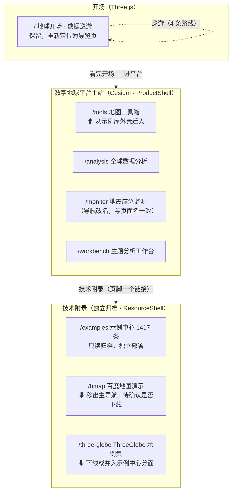

# 产品重整规划（PRODUCT_PLAN）

> **文档性质**：诊断 + 收口 + 重整路线图。本文件是**唯一对外表达「这个项目是什么、要变成什么」的产品文档**。
> **作者**：许清楚（PM） · **日期**：2026-09-23 · **状态**：已部分拍板（2026-09-24）
> **2026-09-24 拍板结论**：Q1=保留 `/` 为开场页；Q2=`/three-globe`、`/bmap` 维持现状（**推翻**本文 §4.2 建议）；Q3+Q4=暂不部署、只做构建拆分，上线等明确需要；Q7=时间盒改为一个月、目标「随时可发布」。同场拍板远端/CI 继续搁置。逐项落点见 `docs/ROADMAP.md` §1「2026-09-24 需求方拍板」块。Q5（引擎对外讲法）留待「关于页」文案时定，Q6（凭据白名单）留待上线前。
> **本次工作为只读分析**：未修改任何代码，唯一新增文件即本文件。
>
> 所有结论均给出文件/行号/命令作为证据。查不到的地方写「未核实」，不编。
> 文中「实测」= 我在 2026-09-23 在本机跑出来的数字，**不是引用文档里的旧值**。

---

## 0. 这次做了什么

| 动作 | 范围 |
|---|---|
| 通读文档 | `AGENTS.md`、`README.md`、`CONTRIBUTING.md`、`docs/` 下 11 份（ROADMAP / ARCHITECTURE / CHANGELOG / TS_MIGRATION / KNOWN_PITFALLS(A 类 + B 类) / DEPLOY / PERF_BASELINE / PAGES_ENHANCEMENT_PLAN / TOUR_ROUTES / THREE_UPGRADE 扫读） |
| 读代码 | `src/App.vue`、`src/router/index.ts`、`src/shells/*`、`src/views/*`（含 `tools-examples/index.ts`、`BMap/`）、`src/examples/registry/index.ts`、`src/three/layers/index.ts` |
| 跑命令 | `git status/log/remote/branch`、`find/wc` 计数、`du -sh dist`、`grep` 测试分布与路由覆盖、`grep '"id":'` 注册表条目数 |
| 未做 | 未跑 `npm run verify` / `build` / `test:e2e`（耗时 7~37 分钟且与诊断结论无关）；未读 `KNOWN_PITFALLS.md` 全文（48 KB，只读了 A/B 类「静默假通过/静默丢数据」与目录） |

---

# 一、现状盘点（事实层）

## 1.1 页面清单：路由 → 页面 → 状态 → 守护测试

证据：`src/router/index.ts:22-38`（共 13 条记录，含 404 catch-all）。

| # | 路由 | 组件 | 顶栏外壳 | 页面性质 | ROADMAP 定义的状态 | E2E 守护（实测 `grep -h "test('" tests/*.ts \| wc -l` = 137 条） |
|---|---|---|---|---|---|---|
| 1 | `/` | `views/EarthView.vue`（706 行） | ProductShell | Three.js 手绘地球：12 个可视化模式 + 巡游 + 双屏对比 | 「旧首页，**保留待评估是否替换**」（ROADMAP:81） | 强：`smoke` 20 + `earth-*` 16 + `tour` 7 + `viz-loading` 4 |
| 2 | `/three-globe` | `views/ThreeGlobeGallery.vue`（510 行） | ResourceShell | three-globe 库的示例集（聚合期产物） | **ROADMAP 存量处置里完全没提**（ROADMAP:79-85 只写了旧首页/巡游/示例中心） | **零功能用例**：仅作为 `smoke.spec.ts:104` 一条卸载竞态用例里的点击目标 |
| 3 | `/three-globe/:example` | `views/GlobeDemo.vue`（478 行） | ResourceShell | 单个 three-globe 演示 | 同上 | **零** |
| 4 | `/examples` | `examples/views/ExampleGallery.vue` | ResourceShell | 示例中心：11 来源 / **1417 条**（实测） | 「归档模式（只读）」已拍板（ROADMAP:14-17） | 中：`smoke` 若干 + `example-*` 13 条 |
| 5 | `/examples/:source/*` | `examples/views/ExampleDemo.vue` | ResourceShell | 示例详情 + 查看源码 | 同上 | 中：`smoke.spec.ts:314/323/338/358` |
| 6 | `/bmap` | `views/BMap/index.vue`（348 行）+ 46 个 BMap 组件 | ResourceShell | 百度地图 GL 集成演示 | **同上，未提** | 弱：仅 `smoke.spec.ts:369` 一条「降级 or 就绪」用例；**无 AK 则整页降级** |
| 7 | `/tools` | `views/MapToolsGallery.vue` | **ResourceShell** ⚠ | 平台页②地图工具箱（17 张卡片列表） | 「P0 MVP + 两批增强已完成」 | 弱：`tools-examples.spec.ts` 4 条 |
| 8 | `/tools/:slug` | `views/MapToolsExampleView.vue` + `views/tools-examples/`（19 文件） | **ResourceShell** ⚠ | 单个工具/组件示例 | 同上 | 中：`map-tools.spec.ts` 28 条（大部分打在 `/tools/toolbox`） |
| 9 | `/analysis` | `views/AnalysisView.vue`（918 行） | ProductShell | 平台页①全球数据分析 | 「P1 MVP 已完成」 | 强：`analysis.spec.ts` 15 条 |
| 10 | `/workbench` | `views/WorkbenchView.vue`（881 行） | ProductShell | 平台页④主题分析工作台 | 「P3 MVP 已完成」 | 强：`workbench.spec.ts` 15 条 |
| 11 | `/monitor` | `views/MonitorView.vue`（1015 行） | ProductShell | 平台页③业务监控（地震） | 「P2 MVP + 真实数据链路已完成」 | 强：`monitor.spec.ts` 15 条 + `server/test` 10 条 |
| 12 | `/:pathMatch(.*)*` | `views/NotFoundView.vue` | ProductShell | 404 | 2026-09 新增 | `smoke.spec.ts:420` |

**实测计数补充**：
- registry 条目数 1417（与文档一致）：`grep -h '"id":' src/examples/registry/*.ts | wc -l` → `1417`
- `.vue` 文件总计 **1527**，其中 `src/examples/components/` 1436：`find src -name '*.vue' | wc -l` / `find src/examples -name '*.vue' | wc -l`
- 平台四页全部走 Cesium：`AnalysisView.vue:290`、`MonitorView.vue:286`、`WorkbenchView.vue:193`、`tools-examples/ToolboxExample.vue:575` 均 `import { createMapViewer } from '../map/createViewer'`
- 首页走 Three.js：`src/three/`（52 文件 / 6041 行）

## 1.2 主线边界：文档里三条，代码里只有两条壳

这是整个「乱」的结构性起点，先摆事实：

| 主线定义 | 出处 | 成员 | 在代码里的载体 |
|---|---|---|---|
| A. 数据产品 | `AGENTS.md:22`、`ARCHITECTURE.md:10` | `/`、`/analysis`、`/workbench`、`/monitor` | `ProductShell.vue` |
| B. 示例资源库 | `AGENTS.md:23`、`ARCHITECTURE.md:11` | `/examples`、`/three-globe`、`/tools`、`/bmap` | `ResourceShell.vue` |
| C. 数字地球平台 | `ROADMAP.md:44-51` | `/tools`、`/analysis`、`/monitor`、`/workbench` | **没有载体 —— 横跨 A 和 B 两个外壳** |

分壳逻辑只有 12 行（`src/App.vue:36-39`）：

```ts
const RESOURCE_PREFIXES = ['examples', 'three-globe', 'tools', 'bmap']   // App.vue:27
const shell = computed(() => {
  const first = route.path.split('/')[1]
  return RESOURCE_PREFIXES.includes(first) ? ResourceShell : ProductShell
})
```

即：**「数字地球平台」这条主线在产品定义里存在，在信息架构里不存在。** 它被 `App.vue:27` 那个数组切成两半，一半（`/tools`）塞进了示例库，一半（其余三个）留在产品壳。

## 1.3 目录职责与规模（实测）

命令：`find src -type f \( -name '*.vue' -o -name '*.ts' \) -not -path 'src/examples/*' | xargs wc -l`

| 目录 | 文件数 | 代码行数 | 职责（按代码与文档交叉验证） |
|---|---|---|---|
| `src/examples/components/` | 1473 | **283,863** | 1417 条示例的 Vue 组件（1436 个 .vue，多出的 19 个是共享壳等） |
| `src/examples/jsm-compat/` | 593 | ~227,049 | three.js addons 的**本地 vendored 副本**（外部代码，不迁 TS） |
| `src/examples/three-build-compat/` | 6 | **256,641** | three.js **r186dev 预发布 build**（`vite.config.ts` 的 `threeCompatResolver` 把 `three` 重定向到这里） |
| `src/examples/registry/` | 13 | ~23,000（按字节估） | 11 个来源注册表（408 KB 的 `threejsOfficialExamples.ts` 是最大单文件） |
| `src/three/` | 52 | 6,041 | 首页 Three.js 渲染层：layers(17) / objects(16) / data / geo / tours |
| `src/map/` | 11 | 2,407 | **四个平台页的 Cesium 底座**：`createViewer.ts`(303) / `mapToolsController.ts`(1158) / `cesiumLoader.ts` / `terrainSampler.ts` / `analysis/` / `monitor/` |
| `src/views/` | 78 | 14,179 | 页面级组件（含 `tools-examples/` 19 个、`BMap/` 46+1 个） |
| `src/components/` | 13 | 3,407 | 首页专用 UI 组件（LayerPanel / InfoPanel / Toolbar / TourOverlay…） |
| `src/composables/` | 9 | 1,217 | 首页用 composable（useScene / useRenderLoop / useTourEngine…） |
| `src/stores/` | 5 | 286 | Pinia：earth / layer / timeline / interaction / theme |
| `src/shells/` | 3 | 261 | 两个顶栏外壳 + 共用 `ShellNav.vue` |
| `src/router/` | 1 | 69 | 路由表 |

> **关键比例**：平台侧（非 `src/examples/`）代码 **27,525 行**，`src/examples/` 合计 **约 79 万行**。
> **平台代码占 src 代码量约 3.5%。** 而平台四页是对外展示的核心资产。

## 1.4 文档体系（`docs/` 11 份 + 根级/子系统 5 份 = 16 个入口）

| 文档 | 大小 | 性质 | 是否仍「当前有效」 |
|---|---|---|---|
| `README.md` | 6.6 KB | 项目介绍 / 命令 / 目录 | ⚠ 已漂移（见 §2 D6） |
| `AGENTS.md` | 15 KB | AI 代理入口：9 条铁律 + 闸门 | ⚠ 路由表缺项（见 §2 D6） |
| `CONTRIBUTING.md` | 5.3 KB | 提交规范 / 常见改动 / 红线 | ✅ |
| `docs/ROADMAP.md` | 16 KB | 范围声明 + 路线图 + 待办 + 不做清单 | ✅（唯一待办真源） |
| `docs/ARCHITECTURE.md` | 9.5 KB | 架构与关键机制 | ⚠ 路由表缺项、计数过时 |
| `docs/KNOWN_PITFALLS.md` | 48 KB | 历史坑（A 静默假通过 / B 高危 / C 运行时 / D 凭据 / E TS 迁移） | ✅（最有价值的一份） |
| `docs/CHANGELOG.md` | 37 KB | 治理轮次归档 | ✅ |
| `docs/TS_MIGRATION.md` | 25 KB | TS 迁移计划 | ⚠ **已全部完成**，性质上应转为归档 |
| `docs/DEPLOY.md` | 7.5 KB | 部署形态与托管要求 | ✅ 但结论是「**尚无线上环境**」 |
| `docs/PERF_BASELINE.md` | 7.7 KB | 性能基线 | ✅ 但自述「只测量不断言」 |
| `docs/THREE_UPGRADE.md` | 4.8 KB | three 兼容层退出步骤 | ✅ |
| `docs/TOUR_ROUTES.md` | 6.3 KB | 巡游分镜数据 | ✅ |
| `docs/PAGES_ENHANCEMENT_PLAN.md` | 13.8 KB | **一次性 AI 任务书**（2026-09-15，已执行完） | ⚠ 任务书混入 docs/，且内容已漂移 |
| `docs/PAGES_REVIEW_REPORT.md` | 13.4 KB | **一次性审查报告**（2026-09-15） | ⚠ 同上 |
| `scripts/README.md`、`server/README.md` | — | 子系统说明 | ✅ |

## 1.5 工程闸门现状

`npm run verify` 实际串 **7 项**（`package.json:26`）：
`check:secrets` → `verify:registry` → `verify:drift` → `verify:thumbnails` → `verify:three-compat` → `verify:gl-renderer` → `verify:theme`

> 2026-09-24 由 6 项增至 7 项：新增 `verify:gl-renderer`（守 `jsm-compat/gl-renderer.esm.js`
> 与上游 UMD 的漂移），并顺带修正 `README.md` 里「五项 + 表格漏 `verify:theme`」的滞后。

| 闸门 | 本地状态 | CI 状态 |
|---|---|---|
| `check:secrets` | 文档称通过 | **CI 从未真正执行过** |
| `verify` 7 项 | 文档称全绿（ROADMAP:99、CHANGELOG:36） | 同上 |
| `typecheck` | 文档称 0 error | 同上 |
| `lint:ci` | 文档称 0 error / 4 warning | 同上 |
| `build` | 文档称 EXIT=0 | 同上 |
| `test:e2e`（dev + preview） | 文档称 15/15、99 过 | 同上 |
| `test:server`（node:test） | 文档称 10 条 | 同上 |

⚠ **上表每一行的「文档称」都来自 ROADMAP:99 的自述**，本次未实测。CI 定义本身是完整的（`.github/workflows/ci.yml`，13 步，含 dev + preview 双模式 E2E），但 `ci.yml:25-27` 自己写着「首跑存在被误杀的风险」。

## 1.6 仓库与交付现状（实测命令）

| 事实 | 命令 | 结果 |
|---|---|---|
| **没有任何 git remote** | `git remote -v` | 空 |
| 243 个提交仅在本机 | `git log --oneline \| wc -l` | 243（2026-07: 42，2026-09: 201；**8 月无提交**） |
| 分支 | `git branch -a` | `main`（当前）+ `backup/ts-pre-squash` |
| 工作树脏 | `git status --short` | **10 项**：7 改（`docs/ROADMAP.md`、`src/map/analysis/choropleth.ts`、`src/map/monitor/useEarthquakeFeed.ts`、`src/views/MonitorView.vue`、`src/views/WorkbenchView.vue`、`tests/monitor.spec.ts`、`tests/workbench.spec.ts`）+ 3 未跟踪（`.zcodeignore`、`src/map/monitor/quakeSource.ts`、`tests/helpers/quakes.ts`） |
| 产物体积 | `du -sh dist` | **1.4 GB** |
| 产物文件数 | `find dist -type f \| wc -l` | **15,406** |
| public 大头 | `du -sh public/*` | `threejs-official` 414M、`external-examples` 366M、`three-project` 365M、`example-thumbs` 28M |
| AI 工具目录进了版本库 | `git ls-files \| grep -E "^\.(trae\|workbuddy)"` | `.trae/` 8 个文件 + `.workbuddy-ai/memory/*.md` |

---

# 二、「乱」的诊断

> **一句话根因**：项目在「聚合示例」阶段长到 1417 条之后（2026-07），才在 **2026-09-14** 决定转型为「数字地球平台」。
> 转型只做了**加法**（新增四个页面、拆壳、TS 迁移、可发现性整改），**一次减法都没做**。
> 所以「乱」不是缺结构，而是**结构层数太多、每一层都还活着**：
> 两套渲染引擎 + 三条主线定义 + 两个外壳 + 13 条路由 + 15 份文档 + 4 代历史页面，全部并存。

下面按六个维度拆成 13 条可归因的问题。每条 = **现象 → 证据 → 影响**。

---

## D1【产品定位层】一个仓库里跑着三个互相打架的产品定义

**现象**：问「这个项目是什么」，三份文档给三个答案。

| 出处 | 定义 |
|---|---|
| `README.md:3-6` | 「基于 Vue 3 + Vite + Three.js + Cesium 的 **3D 数据可视化项目**」，两条主线：首页地球应用 + 示例中心 |
| `AGENTS.md:13-23` | 「**TerraVista 3D**」，两条主线：**数据产品** + **示例资源库**（1417 条 / 1523 组件） |
| `ROADMAP.md:30-52` | 「地球应用从『数据可视化 demo 集合』重构为**数字地球平台**」，四页面 × 各自闭环 |

**影响（对用户/招聘方，严重）**：
- 访客点开链接，30 秒内说不出「这是软件还是素材库」——这正是 `AGENTS.md:25-28` 记录过的旧病，当时归因于「8 项顶栏」，**但根因是定位本身没定，顶栏只是症状**。拆壳治了症状。
- 三个名字（TerraVista 3D / 数字地球平台 / 示例中心）对外讲不清。**作品集展示的目标下，这是第一致命项。**

---

## D2【产品定位层】新旧并存：5 个「地球」入口、两套渲染引擎

**现象**：仓库里有五个能点开的「地球」，分属两套完全不同的引擎。

| 入口 | 引擎 | 证据 |
|---|---|---|
| `/` | **Three.js**（手绘地球 + 12 个可视化模式 + 巡游 + 双屏对比） | `src/views/EarthView.vue:158-170` 的 `vizModes` 12 项：GDP / 人口 / 碳排放 / 贸易 / 航班 / 地震 / 夜间灯光 / 中国 / 地标 / 热力图 / 导入数据 / 默认 |
| `/analysis` | **Cesium** | `AnalysisView.vue:290` |
| `/workbench` | **Cesium** | `WorkbenchView.vue:193` |
| `/monitor` | **Cesium** | `MonitorView.vue:286` |
| `/tools/toolbox` | **Cesium** | `tools-examples/ToolboxExample.vue:575` |

**影响（对用户，严重）**：
- 招聘方会问「你用的是 Three.js 还是 Cesium？」——两套都在且无分工说明 = 两套都不深。
- **默认入口 `/` 展示的是旧的那一套**（Three.js 手绘地球），而 ROADMAP 已把终态定为「数字地球平台」。访客第一眼看到的不是你想展示的东西（ROADMAP:81 自己也写了「待四页面成型后再评估是否替换默认页」）。
- `/` 的 12 个模式里「GDP / 人口 / 碳排放 / 地震」与 `/analysis`、`/monitor` **内容重叠**（一个 GDP 在首页和 `/analysis` 各画一遍，两套色阶、两套交互）。

---

## D3【信息架构层】平台四页面被拆进两个外壳，`/tools` 挂错了壳

**现象**：ROADMAP 把 `/tools` 定义为数字地球平台页②，但代码里它在示例库外壳，与「示例中心 / ThreeGlobe / 百度地图」并列。

**证据**：
- `src/App.vue:27` — `RESOURCE_PREFIXES = ['examples', 'three-globe', 'tools', 'bmap']`
- `src/shells/ResourceShell.vue:55-60` — `links = [示例中心, ThreeGlobe, 地图工具箱, 百度地图]`
- `src/shells/ProductShell.vue:25-30` — `links = [地球, 全球分析, 分析工作台, 业务监控]`

**影响（对用户，严重）**：
- 从 `/tools` 的顶栏**看不到** `/analysis` `/workbench` `/monitor`，要跨平台得先点「返回地球」再找。
- 一个平台的四个页面，两个入口、两套导航。这是 D1 在 UI 层的直接后果，也是用户说的「页面功能非常乱」的**残留部分**——2026-09 拆壳只拆了「产品 vs 示例库」，**没拆掉 `/tools` 这个历史错位**。

---

## D4【信息架构层】导航名与页面名不一致，且代码里写明了「知道但没改」

**现象**：顶栏叫「业务监控」，页面标题叫「地震应急监测」；顶栏叫「地图工具」，页面叫「地图工具箱」。

**证据**：`src/router/index.ts:19-21` 的注释原文——

> 「两者目前并不一致（导航「业务监控」vs 页面「地震应急监测」，导航「地图工具」vs 页面「地图工具箱」），标签页应当和打开后的页面自洽。」

当时的处置是「title 取页面上的名字」绕开，**没有统一命名**。

**影响（对用户，中）**：认知负担 + 对外讲的时候两套叫法。`ResourceShell` 里还叫「地图工具箱」、`ProductShell` 里叫「全球分析」（ROADMAP 叫「全球数据分析」）——**三个地方三个名字**。

---

## D5【信息架构层】两个僵尸页面：`/three-globe` 与 `/bmap`

**现象**：这两个页面 ① 不在任何一条主线的定位描述里 ② 几乎无测试 ③ 却和示例中心平级挂在顶栏。

**证据**：
- ROADMAP:79-85「存量处置（已拍板）」只列了：旧首页、巡游、示例中心、kepler 方向。**`/three-globe` 与 `/bmap` 零提及**。
- 测试覆盖：`grep -rn "three-globe" tests/` 只命中 `smoke.spec.ts`，且 `smoke.spec.ts:104` 只是把它当作「首页卸载竞态」用例里的一个 `click()` 目标，**没有任何功能断言**；`/bmap` 只有 `smoke.spec.ts:369` 一条「有 AK 就绪 / 无 AK 降级」用例。
- `/bmap` 的展示风险：`DEPLOY.md:100` 与 `KNOWN_PITFALLS C9` —— 百度地图 GL SDK 必须解析期注入，**无 AK 整页降级**。
- 46 个 BMap 组件（`ls src/views/BMap/components | wc -l`）是 2026-07「接入期」的产物，与平台方向无关。

**影响（对用户，中）**：招聘方翻顶栏时会点到两个「不知道为什么在这里」的页面，其中一个还可能因为没配 AK 而降级。**每个多余的入口都在稀释你真正想展示的东西。**

---

## D6【文档层】16 个文档入口、无单一权威索引、已实测漂移 6 处

这是本项目自己预言过、并且正在发生的问题。`AGENTS.md:186-188` 原文：

> 「历史教训：文档里的『校验项数』『分包机制』这类**结构性描述**一旦滞后，比数字过时更危险 —— 会让人按错误的心智模型动手。」

实测漂移清单（全部可复现）：

| # | 事实 | 文档 A | 文档 B | 真相（实测） |
|---|---|---|---|---|
| 1 | `npm run verify` 串几项 | ~~`README.md:58`「**五项**校验」+ 表格 5 行（缺 `verify:theme`）~~ **2026-09-24 已修**（改为「七项」并补齐 `verify:theme` / `verify:gl-renderer` 两行） | ~~`AGENTS.md:81`「**6 项**」~~ 已同步为「7 项」 | `package.json:26` = **7 项** |
| 2 | `.vue` 组件数 | `README.md:90`「**1429** 个示例组件」 | `AGENTS.md:23`「**1523** 个」 | `find src -name '*.vue' \| wc -l` = **1527**（examples 下 1436） |
| 3 | typecheck 覆盖 | `README.md:51`「**1500** 个 `.vue`」 | `ci.yml:55`「实测 **1500** 个」、`CHANGELOG.md:154`「实测 1500 个」 | 同上 = **1527** |
| 4 | 路由表 | `AGENTS.md:30-31`：**8 条，缺 `/workbench` 与 `/tools/:slug`** | `ARCHITECTURE.md:23-24`：**只有 6 条**，缺 `/tools` `/analysis` `/workbench` `/monitor` | `src/router/index.ts:22-38` = **13 条**（含 404）。**只有 `README.md:82` 是完整且对的** |
| 5 | 文件扩展名 | `README.md:82` `src/router/index.js`、`README.md:89` `registry/index.js` 全篇 `.js` | `AGENTS.md` 已改 `.ts` | 实测全为 `.ts`（TS 迁移 2026-09 已完成） |
| 6 | 示例条数 | `PAGES_ENHANCEMENT_PLAN.md:20`「`/examples`（**166** 条示例库）」 | 其余均写 1417 | **1417** |

**索引不覆盖**：`README.md` 文档表（9 行）与 `AGENTS.md` 文档地图（15 行，2026-09-24 新增 2 行调研/修复报告）互不覆盖——README 有 `TOUR_ROUTES` 但无 `CHANGELOG`/`TS_MIGRATION`；AGENTS 反之。`docs/PAGES_ENHANCEMENT_PLAN.md`、`docs/PAGES_REVIEW_REPORT.md` 至少有一份没被任何索引收录。

**影响（对贡献者/AI 代理，严重）**：任何人（含 AI 代理）接手时，会按错误的心智模型动手——这正是 `KNOWN_PITFALLS` A/B/E 类坑反复出现的土壤。

---

## D7【文档层】任务书 / 一次性报告 / 归档 / 规范在 `docs/` 里平级混杂

**证据**：
- `docs/PAGES_ENHANCEMENT_PLAN.md:3` 自述「本文档是**自包含任务书**：面向被指派『审查现有功能并添加增强』的 AI 代理」，且第 24-27 行写明**已执行完毕**。
- `docs/PAGES_REVIEW_REPORT.md` 是 2026-09-15 的**一次性审查报告**。
- `docs/TS_MIGRATION.md` 的批次状态表（§3）**全部 ✅ 已完成**，`@ts-nocheck` 已清零。
- `docs/CHANGELOG.md` 是归档，`docs/ROADMAP.md` 是待办。

**影响（对所有人，中）**：打开 `docs/` 无法区分「现在该看的」和「已经作废的」。ROADMAP:131 自己写过教训「**归档 ≠ 可忽略**」，但没解决「归档 ≠ 当前有效」的标注问题。

---

## D8【代码组织层】示例中心占绝对体积，平台代码被埋没

**证据**：
- 平台侧（非 `src/examples/`）代码 **27,525 行**
- `src/examples/` 合计 **约 79 万行**（components 283,863 + jsm-compat ~227,049 + three-build-compat 256,641 + registry ~23k）
- **平台代码占比 ≈ 3.5%**

**影响（对用户与所有贡献者，严重）**：
- 「熟悉项目」这个动作 90%+ 的成本被示例中心吃掉，而示例中心**已拍板为只读归档**（ROADMAP:14-17），维护成本应趋近于零。
- 招聘展示的核心资产（平台四页）被埋在 1400+ 个示例文件后面，**无论是人还是 AI 代理，找起来成本都极高**。

---

## D9【代码组织层】「看起来分层了，实际没有」的四处

| # | 现象 | 证据 | 影响 |
|---|---|---|---|
| 1 | **两套「示例」机制并存**：`/examples` 的注册表在 `src/examples/registry/`，`/tools` 的注册表在 `src/views/tools-examples/index.ts`（19 个文件含 17 个示例组件） | `src/views/tools-examples/index.ts:29-183`（`TOOLS_EXAMPLES` 17 条） | 加一个示例要去哪套？两处规则不同（后者有「必须传稳定数组引用」的额外约束） |
| 2 | **两个引擎层命名不对称**：Three.js 层叫 `src/three/`（52 文件），Cesium 层叫 `src/map/`（11 文件 / 2407 行，却承载全部四个平台页） | 同上 §1.3 | 改「平台页」时不知道该去 `src/map` 还是 `src/views` |
| 3 | `src/components/`（13 文件）的注释是「**首页**地球应用组件」，但 `src/views/` 里同时躺着 EarthView / AnalysisView / WorkbenchView / MonitorView / MapToolsGallery | 目录与注释 | 组件与视图的归属靠约定而非目录约束 |
| 4 | **死代码**：`src/three/layers/DiseaseLayer.ts`（写了疫情图层）**未被 `src/three/layers/index.ts:1-16` 导出，全仓无引用** | `Grep "DiseaseLayer"` 只命中自身文件 | 对应 ROADMAP:142「巡游不含疫情主题」的拍板，但代码没跟着收口，留了个孤儿 |

---

## D10【工程治理层】三个 P0 全未办，其中「无远端」直接让作品集目标不可达成

| 项 | 证据 | 影响 |
|---|---|---|
| **无 git remote** | `git remote -v` 空；243 提交仅本机；另有 `backup/ts-pre-squash` 分支 | **一次磁盘故障 = 项目全部消失**。且**没有远端 → 没有 CI → 没有部署 → 没有可分享链接**。这是 ROADMAP 里唯一一条让「作品集展示」目标**当前不可达成**的阻塞项 |
| 已泄露凭据未轮换 | `ROADMAP.md:98`、`DEPLOY.md:102-103` | 百度 AK / 天地图令牌曾明文进工作区，应视为已泄露，需轮换 + 配 Referer 白名单 |
| CI 从未真跑 | `ROADMAP.md:99` 自述 + `ci.yml:25-27` 注释「首跑存在被误杀的风险」 | 所有「闸门全绿」的记录**都是本机自述，没有第三方背书**。招聘方看不到 CI badge |
| 工作树脏 10 项 | `git status --short`（7 改 + 3 未跟踪） | 与 `CONTRIBUTING.md:28`「不要把跨天未完成的改动一直留在工作树」**直接冲突**；且 `src/map/monitor/quakeSource.ts`、`tests/helpers/quakes.ts` 是未跟踪的新文件，随时可能丢 |

---

## D11【交付阻塞层】产物 1.4 GB，主流免费托管不可用 —— 即使前面全做完，还是拿不到链接

**证据**：
- `du -sh dist` = **1.4 GB**；`find dist -type f | wc -l` = **15,406**
- `DEPLOY.md:16-18`：产物 ~1.4 GB / 14813 文件，其中 `public/` 拷贝约 **1.2 GB**
- `DEPLOY.md:38`：**「GitHub Pages 不合适」**（官方建议仓库 < 1 GB）
- 1.2 GB 的来源（`du -sh public/*`）：`threejs-official` 414M + `external-examples` 366M + `three-project` 365M ≈ **1.1 GB，全部是示例中心的运行时资源与源码**
- `DEPLOY.md:3`：「**方案文档，尚无线上环境**」

**影响（对用户，致命）**：
- 这是「乱」在成本上的最终体现：**四个平台页被 1417 条示例的 1.1 GB 资产绑架**。
- 即使建了远端、CI 跑通，要拿到一条可分享链接仍需自费服务器/对象存储，且每次全量上传 1.4 GB（DEPLOY.md:41 已写「适合试运行、不适合日常发布节奏」）。
- **「核心交付是可分享的真实功能演示」（ROADMAP:41）这条，当前 0 分。**

---

## D12【债务层】技术债清单与其对可交付性的实际威胁

| 债 | 证据 | 对「可交付性」的威胁 |
|---|---|---|
| 巨石组件 | `ToolboxExample.vue` **1500 行**、`mapToolsController.ts` **1158 行**、`MonitorView.vue` 1015、`AnalysisView.vue` 918、`EarthCanvas.vue` 919、`WorkbenchView.vue` 881；示例侧 `PersonFirstMoveExample.vue` **2085 行** | 中：改一处要读一千行；但都有 E2E 守着，不阻塞交付 |
| 依赖分层未做 | `package.json` 50 个 dependencies 中大量**示例专用**（`@mkkellogg/gaussian-splats-3d`、`web-ifc`、`@sparkjsdev/spark`、`@theatre/*`、`three-gpu-pathtracer`、`@needle-tools/*`…）与平台运行时依赖混装 | 中：安装体积、主包风险（历史上 `@sparkjsdev/spark` 曾让首页预载 1.7 MB 无用库，`CHANGELOG:140`） |
| **three 兼容层未退出** | `src/examples/three-build-compat/`（**256,641 行** r186dev 预发布 build）+ `jsm-compat/` 593 个本地副本，`vite.config.ts` 的 `threeCompatResolver` 把 `three` 重定向到这里 | **高（对招聘展示）**：`package.json` 写 `three@^0.185.0`，**实际跑的是本地预发布产物**。招聘方一问「为什么」就要解释半天；KNOWN_PITFALLS R6/C3 也说明它容易误导调试 |
| E2E 基线不稳定 | `TS_MIGRATION.md:182-192` 登记了整页「本机已知抖动集」（workbench/analysis/monitor/map-tools/tour/viz-loading 十余条）+ Playwright worker 崩溃 + 「**构建与 E2E 不得并发**」铁律 | **高**：CI 首跑大概率会因为这些抖动变红，而团队已经有「看到红先重跑」的习惯（TS_MIGRATION:190），**这个习惯会掩盖真回归** |
| 性能无自动闸门 | `PERF_BASELINE.md:119`「**只测量、不做性能断言**」——这正是首屏从 539 KB 涨到 2999 KB 无人发现的原因 | 中：展示页变慢不会被发现 |
| 大 vendor 块 | `vendor-spark` 4.8 MB、`vendor-web-ifc` 3.4 MB（ROADMAP:116） | 低：不在首屏路径 |
| 仓库根目录杂物 | `build.log` 1.19 MB（已 gitignore）、`.trae/` 8 个文件**已提交**、`.workbuddy-ai/memory/*.md` **已提交**、`scripts/legacy/` 46 个脚本 | 低：但对外开源时是减分项（AI 工具的 memory 文件进了版本库） |

---

## D13【债务层】测试覆盖不均，两处「改了没人知道」

**证据**：137 条用例的分布（`grep -c "test('" tests/*.ts`）：

| 区域 | 条数 | 评价 |
|---|---|---|
| `map-tools` | 28 | 过覆盖（大部分打在 `/tools/toolbox`） |
| `analysis` / `monitor` / `workbench` | 15 / 15 / 15 | 健康 |
| `smoke` | 20 | 健康 |
| `earth-*`（8 个文件） | 16 | 健康 |
| `tour` | 7 | 够用 |
| `example-*`（5 个文件） | 13 | 够用 |
| `tools-examples` | 4 | 偏少（17 张卡片） |
| `viz-loading` | 4 | 够用 |
| **`/three-globe`、`/three-globe/:example`** | **0** | **裸奔** |
| **`/bmap`** | **1**（仅降级） | **基本裸奔** |
| `perf` | 0（只测量） | 无断言 |

**影响**：改动 `/three-globe`、`/bmap` 或首页巡游时**没有回归网**；性能回归无闸门。对「可交付性」的威胁是**「你不知道自己弄坏了什么」**。

---

# 三、定位收口建议

## 3.1 推荐定位（一句话）

> **TerraVista 3D —— 一个基于 CesiumJS 的「数字地球平台」作品集。**
> **四个可独立分享的真实功能页面（地图工具箱 / 全球数据分析 / 地震应急监测 / 主题分析工作台）构成主站；**
> **Three.js 手绘地球保留为开场导览页（数据巡游是它的招牌动作）；**
> **1417 条 Three.js / Cesium / WebGL 示例作为「技术附录」独立归档，证明工程能力，但不进主站首屏。**

三个要点：
1. **主站 = 数字地球平台（Cesium）**，这是对外第一身份，与 ROADMAP §1 的终态一致。
2. **首页 `/` 不删，重新定位为「开场页」**——它是唯一能「一键演 30 秒」的资产（4 条巡游路线 + 字幕 + 相机飞行），恰恰最适合招聘场景的第一印象。**但它的定位从「主应用」降为「导览/开场」**，首页 12 个模式里与平台页重叠的（GDP / 人口 / 碳排放 / 地震）不再作为卖点。
   > ⚠ **建议变更并说明理由**：ROADMAP:81 写的是「旧首页保留在 `/`，待四页面成型后再评估是否替换默认页」。我的建议是**不替换、改定位**，理由：① 巡游是对外演示最强的单点；② 删掉首页会同时删掉 `tour.spec.ts` 7 条 + `earth-*` 16 条用例守护的一整套资产；③ 替换默认页会让 URL `/` 的既有分享链接失效。**保留但降级，成本最低、收益最大。**
3. **示例中心 = 技术附录，不进主站首屏**：它是能力证据（1417 条一致性校验、全量 TS 迁移、11 个来源的溯源登记），但**它的 1.1 GB 资产不该绑架主站部署**（见 D11）。

## 3.2 我否掉的备选

| 备选 | 为什么否 |
|---|---|
| **A. 平台 + 示例中心并列双主线**（现状） | 就是「乱」的本体。已通过拆壳（2026-09）试过一次，只治了顶栏症状，没治定位（D1/D3 仍在） |
| **B. 砍掉示例中心** | ① 违反 ROADMAP:14-17 已拍板的「只读归档」；② 1417 条示例 + 全量 TS 迁移 + 7 项一致性闸门**本身就是工程能力的硬证据**，删掉是自杀式减分。**正确做法不是删，是把它的部署形态与主站解耦** |
| **C. 删掉首页，只留 Cesium 四页** | ① 巡游是唯一「一键演示」资产，删掉可惜；② Three.js 的 17 个图层 + 4 条巡游是另一套技术栈的证据，招聘方会认；③ 首页有 47 条 E2E 守护，是全仓最健康的部分 |
| **D. 把首页迁到 Cesium，统一引擎** | ① 两套引擎是资产不是债，但要说清分工；② 迁移工作量 L 级且要重写巡游引擎；③ `useTourEngine` 已被 `/monitor` 的巡游大屏复用（CHANGELOG:119），动它代价大 |
| **E. 做成一个「大而全的门户」（首页聚合所有入口）** | 与「可分享的真实功能演示」冲突——门户不是功能演示，招聘方不会点第二层 |

---

# 四、信息架构重整方案

## 4.1 重整后的结构



重整后主导航（ProductShell）只有 **5 项**：

| 序 | 入口 | 路由 | 说明 |
|---|---|---|---|
| 1 | 开场 | `/` | 手绘地球 + 一键巡游 |
| 2 | 地图工具箱 | `/tools` | **从 ResourceShell 迁入** |
| 3 | 全球数据分析 | `/analysis` | |
| 4 | 地震应急监测 | `/monitor` | **导航改名**（原「业务监控」） |
| 5 | 主题分析工作台 | `/workbench` | |

示例中心只在页脚/右上角留**一个**链接「技术附录 · 1417 条示例」，`ResourceShell` 成为归档站自己的外壳。

## 4.2 每个现存页面的处置结论

| 路由 | 处置 | 理由 | 依赖 | 顺序 |
|---|---|---|---|---|
| `/` | **保留 + 重新定位** | 巡游是最强演示资产；47 条 E2E 守护 | 定位文案 + 首页首屏话术 | 4 |
| `/analysis` | **保留**，导航名统一为「全球数据分析」 | P1 MVP 已完成，15 条 E2E | — | 2 |
| `/workbench` | **保留** | P3 MVP 已完成，15 条 E2E | — | 2 |
| `/monitor` | **保留 + 改名** | 导航「业务监控」→「地震应急监测」（D4） | — | 2 |
| `/tools` + `/tools/:slug` | **保留 + 迁入 ProductShell** | 它是平台页②，却在示例库壳（D3） | 改 `App.vue:27` + 两个 shell 的 links | **1** |
| `/examples` + 详情 | **保留（只读归档）** | ROADMAP 已拍板 | 部署解耦 | 3 |
| `/three-globe` + `/three-globe/:example` | **建议下线**（路由保留并 302 → `/examples`） | 零功能用例、与示例中心完全同构、ROADMAP 存量处置未提及（D5） | 待确认 Q2 | 2 |
| `/bmap` | **建议移出主导航**（是否下线待确认） | 无 AK 整页降级，展示风险；46 个组件是接入期产物（D5） | 待确认 Q2 | 2 |
| `/:pathMatch(.*)*` | **保留** | 2026-09 新增，有守护 | — | — |

## 4.3 迁移顺序（严格的四步，每步可独立验收）

| 步 | 目标 | 内容 | 完成判据 |
|---|---|---|---|
| **第 0 步 · 止损**（最高优先） | 让资产不再处于丢失风险 | 建远端 → 推 `main` → 处理工作树 10 项 → 轮换凭据 → 首跑 CI 并修到绿 | `git remote -v` 有输出；CI 徽章绿；`git status` 干净 |
| **第 1 步 · 导航收口**（半天） | 让「平台」在 UI 上真的是一个平台 | `/tools` 迁 ProductShell；导航改名统一；`/three-globe`、`/bmap` 移出主导航 | 5 项主导航；smoke 的外壳分区用例（smoke.spec.ts:129）仍绿 |
| **第 2 步 · 部署解耦**（拿到链接，最关键） | 让主站能部署 | 主站包剥离示例中心 1.1 GB 资产（见 §5 ENG-P0-5） | 有一条公网可访问的链接，四页全部可用 |
| **第 3 步 · 定位落地**（内容层） | 让访客 30 秒看懂 | 首页开场话术 + 每页能力说明 + 示例中心降为技术附录 | 每页有 30 秒 Self-explainer（§5 PRD-P1-2） |
| **第 4 步 · 文档重整**（可并行） | 让下一个接手的人不再踩坑 | 单一真源 + 归档标注 + 计数校准 | 见 §5 ENG-P1-1 |

> 第 1、3、4 步可并行；第 2 步依赖第 0 步（要有 CI 产物）；第 3 步依赖第 2 步（要有地方看）。

---

# 五、需求池

> 工作量：S ≈ 半天 / M ≈ 1-3 天 / L ≈ 一周以上（单人，含跑全闸门）
> 验收标准一律**可观测**（命令输出 / 页面可见 / CI 状态），不用「优化」「改善」这类不可验收的词。

## 5.1 产品侧

### P0 —— 不做就没有可交付物

| 编号 | 标题 | 要做什么 | 为什么 | 验收标准（可观测） | 量 | 依赖 |
|---|---|---|---|---|---|---|
| **PRD-P0-1** | 定位收口 | 把 §3.1 的定位表述写进 `README.md` 首屏与 `AGENTS.md` §1；全文统一三个名字（TerraVista 3D = 产品名；数字地球平台 = 主站；示例中心 = 技术附录） | D1：三份文档三个定义 | `README.md` 第一段 + `AGENTS.md` §1 表述一致；`grep -rn "数字地球平台" README.md AGENTS.md` 只有一种用法 | S | — |
| **PRD-P0-2** | 导航重整 | `/tools` 迁 ProductShell；主导航 5 项；`/monitor` 改名与页面标题一致；`/three-globe`、`/bmap` 移出主导航 | D3/D4/D5 | 打开 `/tools`，顶栏可见其他 3 个平台页；`ProductShell.vue` links 5 项；`smoke.spec.ts:129` 外壳分区用例通过 | S | ENG-P0-1（先有可回退点） |
| **PRD-P0-3** | 拿到一条可分享链接 | 决策主站/归档站的部署形态（Q3），产出公网可访问 URL | D11：1.4 GB 无法上主流免费托管；「核心交付是可分享的真实功能演示」当前 0 分 | 有一条公网 URL，`/`、`/tools`、`/analysis`、`/monitor`、`/workbench` 五页全部可用且无控制台报错 | M | ENG-P0-1 ~ ENG-P0-5 |

### P1 —— 让展示更有效

| 编号 | 标题 | 要做什么 | 为什么 | 验收标准 | 量 | 依赖 |
|---|---|---|---|---|---|---|
| **PRD-P1-1** | 每页可分享深链自检 | 逐个验证四页的 URL 状态（国家/年份/主题/时间范围）在**全新浏览器打开**能还原 | 作品集要发链接；KNOWN_PITFALLS C11 警告「同一页面 URL 状态只能归一个机制管」 | 四页各 1 条 E2E：`goto(带参数 URL)` → 断言页面状态与参数一致 | M | PRD-P0-3 |
| **PRD-P1-2** | 每页 30 秒 Self-explainer | 四页各加一块「这页在做什么 / 用了什么技术 / 数据从哪来」的说明（可折叠，不占主视觉） | 招聘方不会自己摸索；数据出处也是信任项（USGS 需署名） | 每页首屏可见入口，展开后含：功能一句话 + 技术栈 + 数据源 + 数据时间 | M | — |
| **PRD-P1-3** | 首页开场话术 | 首页首屏加一句定位文案 + 「播放导览」主按钮，把巡游提为首页第一动作 | D2：首页是默认入口，第一眼必须说得清 | 首屏可见品牌定位句 + 一键播放按钮；E2E 断言点击后进入巡游态 | S | PRD-P0-1 |
| **PRD-P1-4** | 示例中心降为技术附录 | 主站页脚一个「技术附录 · 1417 条示例」链接；归档站自己的壳里保留搜索与全部功能 | D8/D11：示例中心不该与主站并列，也不该绑架部署 | 主站 ProductShell 中不再出现示例搜索框；主站产物不含 `public/external-examples` 等 1.1 GB 资产 | S | PRD-P0-3 |
| **PRD-P1-5** | 首页模式与平台页去重说明 | 首页 12 个 `vizModes` 中与平台页重叠的（GDP/人口/碳排放/地震），在 UI 上标注「完整分析见 /analysis」并给出跳转 | D2：同一个 GDP 画两遍，两套色阶 | 首页这 4 个模式的 tooltip/提示含跳转链接；E2E 断言跳转可达 | S | PRD-P1-3 |

### P2 —— 锦上添花

| 编号 | 标题 | 要做什么 | 为什么 | 验收标准 | 量 | 依赖 |
|---|---|---|---|---|---|---|
| **PRD-P2-1** | 首页模式收敛 | `vizModes` 12 → 8，去掉与平台页重复或临时的（导入数据、热力图等，或明确定位为「快速预览」） | D2 | 首页底栏 8 个模式；相应 E2E 同步 | M | PRD-P1-5 |
| **PRD-P2-2** | 作品集「关于」页 | 一页讲清：技术栈、两条引擎的分工、工程治理（7 项闸门 / 137 条 E2E / CI）、数据出处与快照日期 | 招聘方最想看的是「你怎么做的」，不只是「做了什么」 | 新路由 `/about`，在页脚可达；含 CI 徽章与数据源署名 | M | PRD-P0-3 |
| **PRD-P2-3** | 404 与空态产品化 | `NotFoundView.vue` 加回主导航的明确入口；四页的空态（无数据/加载失败）给出「去哪里」而不是一片灰 | 展示时的兜底体验 | 404 页含 5 个主入口链接 | S | — |

## 5.2 工程侧

### P0 —— 资产保全 + 交付打通

| 编号 | 标题 | 要做什么 | 为什么 | 验收标准 | 量 | 依赖 |
|---|---|---|---|---|---|---|
| **ENG-P0-1** | 建远端并推送 | 建 GitHub/GitLab 远端 → 推 `main` 与 `backup/ts-pre-squash` → 启用分支保护 | D10：243 提交仅在本机，一次磁盘故障全丢 | `git remote -v` 有输出；远端含 243 提交；`main` 禁止直推 | S | — |
| **ENG-P0-2** | 处理工作树 10 项 | 逐项判断：提交（`src/map/monitor/quakeSource.ts`、`tests/helpers/quakes.ts` 是新功能，应提交）/ 丢弃（`.zcodeignore` 若为临时文件，待确认）；7 个已改文件按主题拆成小提交 | D10：与 `CONTRIBUTING.md:28` 冲突；未跟踪文件随时可丢 | `git status --short` 输出为空 | S | ENG-P0-1 |
| **ENG-P0-3** | 轮换已泄露凭据 | 在百度/天地图控制台轮换 AK 与 Token → 配 Referer/域名白名单 → 确认 `.env.local` 不入库 | D10 + `DEPLOY.md:102-103`：凭据是前端可见的客户端凭据 | 旧 key 失效；`npm run check:secrets` 绿；白名单已配 | S | — |
| **ENG-P0-4** | 首跑 CI 并修到绿 | 推一次触发 CI；按 `ROADMAP.md:99` 的已知风险逐个修（GitHub 环境差异、`playwright install --with-deps`） | D10：所有「闸门全绿」目前都是本机自述 | CI 全绿；README 加徽章 | M | ENG-P0-1/2 |
| **ENG-P0-5** | 部署形态拆分 | 让 `npm run build` 能产出两种产物：① **主站包**（四页 + 开场页，不含示例中心 1.1 GB 资产）② **归档包**（示例中心，可单独部署或干脆不部署） | D11：1.4 GB 上不了 GitHub Pages，1.1 GB 是示例中心的资产 | 主站包 < 200 MB（可上 Netlify/Vercel/GH Pages）；主站包跑 preview E2E 全绿；`DEPLOY.md` 更新为两种形态 | L | ENG-P0-4 |
| **ENG-P0-6** | 线上部署 + 发布前校验 | 按 `DEPLOY.md` §5 跑发布前校验（含 `copy-example-deps`），上线主站包 | 「核心交付是可分享的真实功能演示」 | 公网 URL 可访问；四页 + 开场页无控制台报错 | M | ENG-P0-5 |

> **ENG-P0-5 是全池唯一 L 级 P0，且它决定 PRD-P0-3 能不能落地。** 若 Q3 决策为「示例中心不单独部署」，则该项降为 M（直接裁剪即可）。

### P1 —— 让项目不再反复踩坑

| 编号 | 标题 | 要做什么 | 为什么 | 验收标准 | 量 | 依赖 |
|---|---|---|---|---|---|---|
| **ENG-P1-1** | 文档体系重整 | ① `docs/` 下**已完成的计划类文档**（`TS_MIGRATION`、`PAGES_ENHANCEMENT_PLAN`、`PAGES_REVIEW_REPORT`）移到 `docs/archive/` 并在头部标注「已完结，仅留痕」；② 建**唯一文档索引**（放 `AGENTS.md` §8，README 改为指向它）；③ 修 D6 的 6 处漂移；④ 把 `.vue` 数 / 示例条数这类计数**改为脚本产出**（扩 `audit-deps.mjs` 或新增 `scripts/audit-docs.mjs`）进 verify 链 | D6/D7：`AGENTS.md:186` 自己预言过「结构性描述滞后比数字过时更危险」，现在正在发生 | `docs/` 只剩当前有效文档；两份索引合并为一；6 处漂移全部修正；计数由脚本产出且 CI 校验 | M | ENG-P0-2 |
| **ENG-P1-2** | 拆巨石（排序执行） | 按收益排序：`ToolboxExample.vue`(1500) → `mapToolsController.ts`(1158) → `MonitorView.vue`(1015) → `EarthCanvas.vue`(919)。**沿用纪律：先补特征测试再拆**（CHANGELOG:145） | D12 | 每个拆分：拆前补 E2E（在旧代码上先绿）→ 拆完仍绿；单文件 < 500 行 | L | ENG-P0-4 |
| **ENG-P1-3** | 依赖分层 | 把 50 个 dependencies 分成「平台运行时」与「示例专用」；示例专用移到可选安装或 `optionalDependencies`；同步 `vite.config.ts` 的 `codeSplitting.groups` | D12：`ROADMAP:107` 已列 P1；历史上曾因分组让首页预载 1.7 MB 无用库 | 平台运行时依赖 ≤ 20 个；首页 JS 传输量不劣化（PERF_BASELINE 口径实测） | L | ENG-P0-4 |
| **ENG-P1-4** | E2E 补洞 + 性能断言 | ① 为 `/three-globe`、`/bmap` 补功能用例（或随其下线而删除相关导航用例）；② `perf.spec.ts` 加**宽阈值断言**（首页 JS ≤ 650 KB，`PERF_BASELINE.md:124` 建议值），只对 JS 断言不对时间断言 | D13 + D12：两处裸奔；性能曾从 539 涨到 2999 无人发现 | 无零覆盖路由；CI 有一条性能断言且当前通过 | M | ENG-P0-4 |
| **ENG-P1-5** | E2E 抖动治理 | 逐个处理 `TS_MIGRATION.md:182-192` 登记的抖动集：能根治的根治（改等待策略），治不了的**显式标注**而不是让团队继续「看到红先重跑」 | D12：这个习惯会掩盖真回归 | 抖动清单从 10+ 条降到 ≤ 3 条且每条有根因说明 | M | ENG-P0-4 |
| **ENG-P1-6** | three 兼容层退出（指定 owner + 月度核对） | 按 `THREE_UPGRADE.md` 执行；每月首周核对 npm `three` 稳定版是否已含 r186 API | D12：package.json 写 0.185，实际跑本地预发布 build —— 对外说不清 | 兼容层目录删除 或 文档中明确记录退出计划与预计时间 | M | — |

### P2 —— 卫生

| 编号 | 标题 | 要做什么 | 为什么 | 验收标准 | 量 | 依赖 |
|---|---|---|---|---|---|---|
| **ENG-P2-1** | 清死代码与根目录 | 删 `src/three/layers/DiseaseLayer.ts`（无引用，对应「巡游不含疫情」拍板）；`build.log` 移出仓库；`.trae/`、`.workbuddy-ai/memory/` 提交进库的部分评估后移除或显式标注 | D9-4 / D12 | 死代码 0；`git ls-files \| grep -E "^\.(trae\|workbuddy)"` 为空或有明确说明 | S | ENG-P0-2 |
| **ENG-P2-2** | vendor 大块切分 | `vendor-spark` 4.8 MB、`vendor-web-ifc` 3.4 MB 用 `codeSplitting.groups` 的 `maxSize` 切分 | `ROADMAP:116`；但明确「仅在确有收益前不动」 | 无单块 > 2 MB 且首屏不受影响 | S | ENG-P1-3 |
| **ENG-P2-3** | `scripts/legacy/` 处置 | 46 个一次性脚本：确认不再需要的删除，需要的加 README 说明 | D12 | `scripts/legacy/` ≤ 10 个或全部有说明 | S | ENG-P0-2 |
| **ENG-P2-4** | 目录职责澄清 | `src/map/` 更名或在 `ARCHITECTURE.md` 明确它是「平台 Cesium 底座层」；`src/views/tools-examples/` 的两套示例机制注明差异 | D9 | `ARCHITECTURE.md` 有一节讲清「去哪改什么」 | S | ENG-P1-1 |

---

# 六、明确不做清单（止损线）

## 6.1 沿用既有决策（不推翻）

| 不做 | 出处 |
|---|---|
| 不再接入新的示例来源 | `ROADMAP.md:5-12` |
| 示例中心为只读归档，只修坏死、不改内容风格 | `ROADMAP.md:14-17` |
| 地球应用不做移动端适配（仅 PC 端） | `ROADMAP.md:141` |
| 巡游路线不包含疫情主题 | `ROADMAP.md:142` |
| 不为历史转换产物做逐文件代码风格整改 | `ROADMAP.md:143-144` |
| 不批量改写 448 条同名标题 / 499 条重复描述 / 重做标签体系 / 加收藏与推荐位 | `ROADMAP.md:25` |
| 不为降低产物总量做全量瘦身 | `PERF_BASELINE.md:112-113` |
| `jsm-compat` / `three-build-compat` 作为外部代码，不迁 TS | `TS_MIGRATION.md:37-39` |

## 6.2 本次新增的止损线（针对「继续蔓延」这个真正的恐惧）

1. **不再新增页面。** 任何新能力必须在现有五页（`/`、`/tools`、`/analysis`、`/monitor`、`/workbench`）内承载。要新增第六页，必须同时下线一个现存页。
2. **不再新增文档。** 新内容进既有文档；确需新文档，必须先在唯一索引里登记并移除一份等量的旧文档。
3. **不再新增示例来源，也不再扩展 `/tools` 的 17 张卡片**（除非下线等量的）。
4. **不新增依赖**，除非有 P0 阻塞且无替代方案；新增前先跑 `npm run audit:deps`。
5. **不做首页 → Cesium 的迁移**（D 备选），两套引擎的分工靠文档说清，不靠统一技术栈。
6. **不做示例中心的视觉/交互整改**，只修坏死（构建失败、白屏、封面缺失、闸门变红）。
7. **不追求「删掉示例中心」**（B 备选）——改部署形态，不改存在性。
8. **不做「门户化」**——不加首页聚合所有入口的导航页，那会让「可分享的真实功能演示」变成「一个需要探索的网站」。

---

# 七、待确认问题（需要你拍板）

> 这七条都是**无法从代码里查到、且不同选择会导致完全不同的工作量与结果**的问题。

| # | 问题 | 选项 A | 选项 B | 为什么必须你定 |
|---|---|---|---|---|
| **Q1** | **默认入口**：访客打开域名，第一眼是 `/`（Three.js 开场 + 巡游），还是 `/analysis`（Cesium 平台页）？ | 保留 `/` 为默认（我的建议：巡游是最强开场，且保留 47 条 E2E 守护的资产） | 改为平台页（更贴合「数字地球平台」定位，但 `/` 的既有分享会失效，且巡游资产被埋） | 决定首页是「保留降级」还是「保留为主」，两种定位的后续投入差一个量级 |
| **Q2** | **`/three-globe` 与 `/bmap` 怎么处置？** | **仅移出主导航**（S 级，改两个 shell 的 links） | **下线**（M 级，删路由 + 删 `ThreeGlobeGallery`/`GlobeDemo` 988 行、`BMap/` 5336 行含 46 个组件 + 同步 E2E） | 两者都是零功能用例（D5），但下线要删代码；`/bmap` 下线还意味着放弃百度地图集成这块能力展示 |
| **Q3** | **部署形态**：示例中心与主站是否拆成两个站点？ | **拆**（主站 < 200 MB 可上 GitHub Pages/Netlify；归档站单独部署或干脆不部署） | **不拆**（继续 1.4 GB，需自费服务器/对象存储，每次全量上传） | 这条**直接决定「可分享链接」能否落地**（D11）与 ENG-P0-5 是 L 还是 M |
| **Q4** | **示例中心对外是否展示？** | 展示（作为「技术附录」，证明工程能力：1417 条一致性校验 + 全量 TS 迁移） | 不展示（1.1 GB 资产直接不部署，主站最轻） | 与 Q3 联动；也决定示例中心是否值得继续投入任何维护 |
| **Q5** | **两套引擎怎么对外讲？** | 「Three.js 做开场叙事，Cesium 做真实 GIS 分析」——作为**有意的技术选型**讲 | 「历史遗留，正在收敛」——作为**承认的债**讲 | 招聘方一定会问；讲法影响 Q1 与是否要做引擎统一 |
| **Q6** | **凭据与第三方服务**：你是否有百度地图的**企业认证**？是否愿意为天地图配白名单？ | 有/愿意 → `/bmap` 与 Cesium 示例可完整展示 | 无 → `/bmap` 整页降级、部分 Cesium 示例无瓦片（D5 + `KNOWN_PITFALLS D3`） | 决定 `/bmap` 的存废（Q2）与 ENG-P0-3 的边界 |
| **Q7** | **时间盒**：你希望什么时候拿到第一条可分享链接？ | 一周内（只做第 0 步 + 第 2 步的裁剪版，先有链接再优化） | 一个月（第 0-3 步全做完再发布） | 决定 P0 的排序与是否并行；也决定 PRD-P1/P2 是否进本轮 |

---

## 附录 A：本次诊断用到的命令（可复现）

```bash
# 仓库与交付
git remote -v ; git branch -a ; git log --oneline | wc -l ; git status --short
git ls-files | grep -E "^\.(trae|workbuddy)"
du -sh dist ; find dist -type f | wc -l ; du -sh public/* | sort -rh

# 计数
find src -name '*.vue' | wc -l                                  # 1527
find src/examples -name '*.vue' | wc -l                         # 1436
grep -h '"id":' src/examples/registry/*.ts | wc -l               # 1417
find src -type f \( -name '*.vue' -o -name '*.ts' \) \
  -not -path 'src/examples/*' | xargs wc -l | tail -1            # 27525
find src/examples/components -name '*.vue' | xargs wc -l | tail -1   # 283863
grep -h "test('" tests/*.ts | wc -l                              # 137

# 覆盖与引用
grep -rn "goto('/" tests/*.ts | sed "s/.*goto('\([^']*\)'.*/\1/" | sort | uniq -c | sort -rn
grep -rln "three-globe" tests/                                   # 只有 smoke.spec.ts
grep -rn "createMapViewer" src/views/                            # 四个平台页
grep -rn "DiseaseLayer" src/                                     # 只有自身文件
```

## 附录 B：诊断结论速查（13 条 → 一句话）

| # | 一句话 |
|---|---|
| D1 | 三份文档给三个产品定义 |
| D2 | 5 个地球入口、两套渲染引擎、内容还重叠 |
| D3 | 平台四页被 `App.vue:27` 切成两半，`/tools` 挂错壳 |
| D4 | 导航名与页面名不一致，代码注释里写明了但没改 |
| D5 | `/three-globe`、`/bmap` 是零覆盖的僵尸页 |
| D6 | 15 份文档无单一索引，实测漂移 6 处 |
| D7 | 任务书/报告/归档/规范在 `docs/` 平级混杂 |
| D8 | 平台代码只占 src 的 3.5%，被 1400+ 示例文件埋没 |
| D9 | 4 处「看起来分层了实际没有」+ 1 个死代码图层 |
| D10 | 三个 P0 全未办，无远端 = 作品集目标不可达成 |
| D11 | 产物 1.4 GB，主流免费托管不可用 |
| D12 | three 兼容层「说不清」+ E2E 抖动习惯掩盖真回归 + 性能无闸门 |
| D13 | 137 条用例分布不均，两处裸奔 |

**根因**：2026-09-14 转型为「数字地球平台」后只做加法、没做减法。四代历史（接入期 → 聚合期 → 转型期 → 治理期）全部并存。
