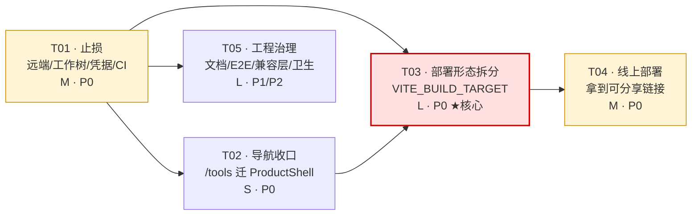
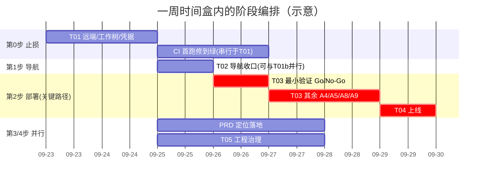

# 工程侧整改路线图（TECH_ROADMAP）

> **文档性质**：工程侧整改的技术设计 + 可执行任务分解。产品侧的需求定义、定位与需求池以 `docs/PRODUCT_PLAN.md` 为准，本文不重复。
> **作者**：高见远（架构师）· **日期**：2026-09-23 · **状态**：已评审采纳（2026-09-24），按需求方拍板修订
> **2026-09-24 修订**：① T02 缩窄——`/three-globe`、`/bmap` 维持现状（§2.1 的 N1 照做、N3 中「移出主导航」部分取消，resourceLinks 只移除「地图工具箱」一项）；② T04 上线暂缓，等「有明确需要」时启动（其前置「凭据轮换 + 删旧 dist + 天地图白名单」随 T04 一起触发）；③ T01 缩窄——远端、CI 首跑、凭据轮换均搁置，仅保留「清理工作树」；④ T03 照做，但 CI job（A9）与徽章相关项随远端搁置一起延后，验收以本地 V1~V7 为准。详见 `docs/ROADMAP.md` §1「2026-09-24 需求方拍板」块。
> **本次工作为只读分析**：未修改任何代码，唯一新增文件即本文件。
>
> 所有结论均给出文件/行号/命令作为证据。查不到的地方写「未核实」，不编。
> 文中「实测」= 2026-09-23 在本机跑出来的数字。

---

## 0. 这次做了什么

| 动作 | 范围 |
|---|---|
| 通读 | `docs/PRODUCT_PLAN.md`（608 行，全文）、`AGENTS.md`（201 行，全文）、`docs/DEPLOY.md`（157 行，全文） |
| 读代码 | `vite.config.ts`（238 行，全文）、`src/App.vue`、`src/router/index.ts`、`src/main.ts`、`index.html`、`src/shells/*`（3 个，全文）、`src/examples/components/index.ts`（全文）、`src/examples/registry/index.ts`（全文）、`src/map/cesiumLoader.ts`（全文）、`scripts/copy-example-deps.js`（全文）、`scripts/verify-three-compat.mjs`（全文）、`playwright.config.ts`（全文）、`.github/workflows/ci.yml`（全文）、`package.json` |
| 跑命令 | `du -sh dist/*` 与 `dist/node_modules/*`、`find dist -type f` 分目录计数、`du -sh public/*`、按 chunk 名切分 `dist/assets` 体积、`grep` 平台侧对 `public/*` 各子目录的引用、`grep` 跨目录 import 边界、`cat dist/index.html` 与 `index.html` 对比 |
| 未做 | 未跑 `npm run verify` / `build` / `test:e2e`（耗时 7~37 分钟，且与架构结论无关）；**未做验证性构建**（这是只读任务，方案 A 的体积收益是按产物实测值推算的，见 §3.5，落地前必须实测一次） |

### 0.1 与 PRODUCT_PLAN 的关系

本文是 `PRODUCT_PLAN.md` §5.2 工程侧需求池（ENG-P0-1~6 / ENG-P1-1~6 / ENG-P2-1~4）的**技术展开与重排序**。产品侧的 PRD-\* 项不在本文范围内，只在依赖关系里出现。

---

# 一、现状的技术事实（本次实测，与 PRODUCT_PLAN 互补）

## 1.1 产物体积的精确构成（实测）

命令：`du -sh dist/* | sort -rh`

| 目录 | 体积 | 平台是否需要 | 证据 |
|---|---|---|---|
| `dist/external-examples` | **426 M** | ❌ | 平台侧 0 个文件引用（见 §1.3） |
| `dist/threejs-official` | **415 M** | ❌ | 同上 |
| `dist/three-project` | **381 M** | ❌ | 同上 |
| `dist/node_modules` | **81 M** | ⚠ **部分** | `cesium` 31M / `cesium-transform-controls` 712K 需要；其余 ~50M 是示例专用 |
| `dist/assets` | **57 M** | ⚠ **部分** | 2683 个 chunk 是示例组件（20M），569 个是平台（22M） |
| `dist/example-thumbs` | **28 M** | ❌ | 示例封面 |
| `dist/graphics` | **26 M** | ❌ | 同上 |
| `dist/granary-3d` | **19 M** | ❌ | 同上 |
| `dist/webgl` | **17 M** | ❌ | 同上 |
| `dist/data` | **13 M** | ✅ | 平台侧 10 个文件引用（`/` 的 worldZh、`/monitor` 的 quake 快照） |
| `dist/three-globe-data` | **3.4 M** | ❌ | 仅 `src/views/GlobeDemo.vue:163/221/268/391` |
| `dist/mygrapics` | **2.4 M** | ❌ | 示例 |
| `dist/textures` | **1.9 M** | ✅ | 平台侧 1 个文件引用 |
| **合计** | **~1.4 GB** | | |

`dist/node_modules` 细分（实测 `du -sh dist/node_modules/*`）：

| 子项 | 体积 | 归属 | 拷贝来源 |
|---|---|---|---|
| `cesium`（Source 8.9M + Build 22M） | 31 M | **平台必需** | `copy-example-deps.js:54-56` |
| `cesium-transform-controls` | 712 K | **平台必需** | `copy-example-deps.js:57-58` |
| `@sparkjsdev/spark` | 30 M | 示例专用 | `copy-example-deps.js:61-62` |
| `three`（build + examples/jsm） | 11 M | 示例专用（注：three 本体走 `three-build-compat` 打包，这里是 `IframeRunner` 运行时用） | `copy-example-deps.js:41-43` |
| `@mkkellogg/gaussian-splats-3d` | 3.4 M | 示例专用 | `copy-example-deps.js:59-60` |
| `postprocessing` | 2.6 M | 示例专用 | `copy-example-deps.js:52-53` |
| `animejs` | 1.6 M | 示例专用 | `copy-example-deps.js:49` |
| `three-mesh-bvh` | 580 K | 示例专用 | `copy-example-deps.js:51` |
| `gsap` / `lil-gui` / `@tweenjs` | ~344 K | 示例专用 | `copy-example-deps.js:44-48/50` |

`dist/assets` 细分（实测）：

```bash
cd dist/assets
ls *.js | wc -l                                  # 3252
ls *.js | grep -ci example                       # 2683  →  du -ch 合计 20M
ls *.js | grep -vi example | wc -l               #  569  →  du -ch 合计 22M
```

> **结论**：示例组件 chunk 占了 `dist/assets` 文件数的 **82%**（2683/3252），占 JS 体积的 **48%**（20M/42M）。

## 1.2 1436 个示例组件是怎么被引用的（关键结论）

**只有一处**，且是 `import.meta.glob`：

- `src/examples/components/index.ts:20`
  ```ts
  const modules = import.meta.glob('./**/*.vue') as Record<string, () => Promise<Component>>
  ```
- `src/examples/components/index.ts:42-46`（第二条 glob，取源码字符串用于「查看代码」）
  ```ts
  const sourceModules = import.meta.glob('./**/*.vue', { query: '?raw', import: 'default', eager: false })
  ```

两条 glob 都是 `eager: false`，所以 Rolldown 会为**每个命中的 `.vue` 生成独立 chunk**（组件本体 + `?raw` 源码两份），这就是 `dist/assets` 里那 2683 个 `Example-*.js` 的来源。

**引用链（全仓唯一）**：

```
src/router/index.ts:27  (lazy route /examples/:source/*)
  → () => import('../examples/views/ExampleDemo.vue')
    → ExampleDemo.vue:93  import { loadExampleComponent, loadExampleSource } from '../components/index'
      → components/index.ts:20 / :42  import.meta.glob('./**/*.vue')
```

`src/examples/components/index.ts` 全仓**只有** `ExampleDemo.vue:93` 一个消费者（实测 `grep -rn "from '.*components/index'" src/`）。

### 这对「能不能 tree-shake 掉」意味着什么

| 事实 | 结论 |
|---|---|
| glob 是**静态**的（`import.meta.glob` 在构建期展开） | ❌ **不能**靠 tree-shaking 自动消除——只要 `components/index.ts` 这个模块还在模块图里，1436 个 chunk 就一定会被产出 |
| 但 glob 所在模块**只被懒加载路由引用** | ✅ **可以**通过「让 `/examples/:source/*` 这条路由不存在」→ `ExampleDemo.vue` 不可达 → `components/index.ts` 被摇掉 → 2683 个 chunk 全部消失 |
| 这些 chunk **不在** `dist/index.html` 的 `modulepreload` 里 | ✅ 它们不污染首屏，只占体积与构建时间 |

> **一句话**：示例组件不是「摇不掉」，而是「只要路由还在就摇不掉」。所以部署拆分的最小切口是**路由表**，不是删文件。这也是方案 A 能做到「7 项闸门零改动」的根本原因。

## 1.3 `public/` 下那 1.1 GB 是怎么进产物的

**不是** `copy-example-deps.js` 干的——它们是 Vite 的 `publicDir` 机制**整目录原样拷贝**的（`public/` → `dist/` 根，不做任何处理、不哈希、不压缩）。

`scripts/copy-example-deps.js` 干的是另一件事（**全文 77 行，逻辑极简**）：

1. 解析 `--outDir` 参数（`:11-14`），默认 `dist`；
2. 若 `dist` 不存在则报错退出（`:65-68`）；
3. 遍历 `deps` 数组（`:40-63`，22 条 `[源相对 node_modules 路径, 目标相对 dist/node_modules 路径]`），用 `fs.cpSync` 递归拷到 `dist/node_modules/`（`:70-74`）。

它贡献的是 `dist/node_modules` 那 **81 MB**，不是 1.1 GB。

**1.1 GB 的真实来源**：`public/` 下的 8 个示例资源目录，被 Vite 无差别拷进产物根。实测平台侧引用数为 0：

```bash
for d in threejs-official external-examples three-project example-thumbs \
         graphics granary-3d webgl mygrapics three-globe-data textures data; do
  printf "%-20s platform-files=%s\n" "$d" \
    "$(grep -rlE "/$d" src/map src/three src/components src/views src/shells src/stores src/composables | wc -l)"
done
```

| public 子目录 | 体积 | 平台侧引用文件数 |
|---|---|---|
| `threejs-official` | 414 M | **0** |
| `external-examples` | 366 M | **0** |
| `three-project` | 365 M | **0** |
| `example-thumbs` | 28 M | **0** |
| `graphics` | 22 M | **0** |
| `granary-3d` | 19 M | **0** |
| `webgl` | 16 M | **0** |
| `mygrapics` | 2.3 M | **0** |
| `three-globe-data` | 3.4 M | 1（`src/views/GlobeDemo.vue`） |
| `textures` | 1.9 M | **1**（平台） |
| `data` | 12 M | **10**（平台） |

> `public/` 合计 **1.2 GB**，其中平台真正需要的只有 `data`（12M）+ `textures`（1.9M）≈ **14 M**。

## 1.4 一个被忽略的硬耦合：平台首页依赖 `src/examples/`（必须先知道）

这是本次分析最重要的发现，直接决定方案选型。

`vite.config.ts` 把 three 的解析**全局**重定向到 `src/examples/` 下的两个目录：

- `vite.config.ts:26-36` — `threeCompatResolver`：`three` / `three/webgpu` / `three/tsl` → `src/examples/three-build-compat/`（6.2M，256,641 行 r186dev 预发布 build）
- `vite.config.ts:129-130` — alias：`three/examples/jsm`、`three/addons` → `src/examples/jsm-compat/`（9.8M，593 文件）
- `vite.config.ts:10-11/128` — alias：`lil-gui` → `src/examples/utils/lil-gui-tracked`

而**平台首页（`/`，Three.js 那一套）大量依赖这三者**，实测：

```
src/three/utils/colorScale.ts:1            import * as THREE from 'three'
src/three/utils/CircleLineGeometry.ts:1    import { BufferGeometry, Vector3 } from 'three'
src/three/data/DataLoader.ts:1             import * as THREE from 'three'
src/three/layers/PopulationLayer.ts:1      import * as THREE from 'three'
src/three/layers/BaseLayer.ts:1            import * as THREE from 'three'
src/three/layers/CarbonLayer.ts:1          import * as THREE from 'three'
src/three/layers/HeatmapLayer.ts:1         import * as THREE from 'three'
src/three/objects/EarthSphere.ts:1         import * as THREE from 'three'
src/three/objects/Labels3D.ts:1            import * as THREE from 'three'
src/components/EarthCanvas.vue:24          import * as THREE from 'three'
src/components/EarthCanvas.vue:26-27       import type { EffectComposer } from 'three/examples/jsm/postprocessing/...'
src/components/EarthCanvas.vue:46-47       import type { OrbitControls } / CSS2DObject from 'three/examples/jsm/...'
src/components/EarthCanvas.vue:815-817     import('three/examples/jsm/postprocessing/EffectComposer.js')  ← 动态
src/composables/useScene.ts:1              import * as THREE from 'three'
src/composables/useCameraFlight.ts:1-2     three + three/examples/jsm/controls/OrbitControls.js
src/composables/useOrbitControls.ts:1      import { OrbitControls } from 'three/examples/jsm/controls/OrbitControls.js'
src/composables/useRaycaster.ts:2          import * as THREE from 'three'
```

> ⚠ **结论**：`src/examples/` **不能整体从平台构建中移除**。
> 平台包必须保留 `three-build-compat/`（6.2M 源码）与 `jsm-compat/`（9.8M 源码），以及 `threeCompatResolver` 与两条 alias。
> 想做「物理拆子包」（方案 B），**前置条件是先把这两个目录搬出 `src/examples/`**，否则平台包会被迫依赖归档包的目录——这在架构上是不可接受的。详见 §3.3。

## 1.5 当前 `modulepreload` 已被污染（实测）

`dist/index.html` 的 preload 列表（实测 `grep -o 'modulepreload[^>]*' dist/index.html`）：

```html
<link rel="modulepreload" crossorigin href="/assets/runtime-core.esm-bundler-BGiP6Eox.js">
<link rel="modulepreload" crossorigin href="/assets/runtime-dom.esm-bundler-DFCmJYNc.js">
<link rel="modulepreload" crossorigin href="/assets/pinia-trYAc59g.js">
<link rel="modulepreload" crossorigin href="/assets/vue-router-BbmodyFi.js">
<link rel="modulepreload" crossorigin href="/assets/rolldown-runtime-aKtaBQYM.js">
<link rel="modulepreload" crossorigin href="/assets/vendor-three-CIdMtn6i.js">        ← 1.3 MB
<link rel="modulepreload" crossorigin href="/assets/vendor-3d-tiles-jkVZElNJ.js">     ← ?
<link rel="modulepreload" crossorigin href="/assets/useExampleFilters-DeDDRaMp.js">   ← 示例侧
<link rel="modulepreload" crossorigin href="/assets/_plugin-vue_export-helper-BDNMzG2s.js">
```

**这条 preload 对全站每一个页面生效**（`/monitor`、`/analysis` 这些根本不用 Three.js 的 Cesium 页面也一样）。

已确认的一条成因（静态边）：

```
src/main.ts → src/App.vue:23  import ResourceShell from './shells/ResourceShell.vue'   ← 静态，无条件
  → src/shells/ResourceShell.vue:53  import { useExampleFilters } from '../examples/composables/useExampleFilters'
    → src/examples/composables/useExampleFilters.ts:2  import { getAllExamples, loadAllRegistries } from '../registry/index.ts'
```

`useExampleFilters` 因此被无条件打进入口 chunk，preload 列表里出现 `useExampleFilters-DeDDRaMp.js` 与之吻合。

`vendor-three`（1.3 MB）与 `vendor-3d-tiles` 为什么在入口 preload 里，**本次未完全定位**：

- `3d-tiles-renderer` 全仓只被 `src/examples/components/three-cesium-examples/threeExamples/expand/LoadTilesExample.vue:13` 与 `src/examples/jsm-compat/misc/TileCreasedNormalsPlugin.js` 引用，二者都在 glob 覆盖范围内（应为懒加载）；
- 但 Rolldown 的 `codeSplitting.groups`（`vite.config.ts:172-213`）会**把命中的库提升为共享 chunk**，共享 chunk 是否进 preload 由 Rolldown 判定，不完全等于「入口静态导入图」；
- 这正是 `AGENTS.md` R7 描述的那类现象（历史上曾让首页预载 1.7 MB 用不到的高斯泼溅库）。

> **处理方式**：不猜。方案落地后必须**实测** `dist/index.html` 的 preload 列表与 `tests/perf.spec.ts` 的数据（见 §3.6 验收命令 V3）。若 `vendor-three` 在平台包的 `/monitor` 上仍被 preload，按 R7 处理：调整 `codeSplitting.groups` 的 `priority` / `includeDependenciesRecursively`，而不是改 `manualChunks`。

## 1.6 附带发现：凭据与产物陈旧（不在本次任务书范围，但与 ENG-P0-3/6 直接相关）

| # | 事实 | 证据 | 影响 |
|---|---|---|---|
| **F1** | **`dist/index.html:12` 里写着一个真实的百度 AK 明文**：`G1LFyjrNGIkns5OfpZnrCGAKxpycPLwb` | 实测 `cat dist/index.html`；`grep -rl "G1LFyjrNGIkns5OfpZnrCGAKxpycPLwb" .` 命中 `.env.local` 与 `dist/index.html` | `dist` 已被 `.gitignore` 忽略（`git ls-files dist` 为空），所以**未进版本库**；但任何人把这个 `dist/` 上传公网 = AK 直接公开。ENG-P0-3（轮换凭据）与 ENG-P0-6（上线）必须串起来做，上线前重新构建 |
| **F2** | **`dist/` 是陈旧产物** | 源码 `index.html` 有「按路径判断、只在 `/bmap` 注入」的逻辑（`if (!/^\/bmap(\/\|$\|\?\|#)/.test(...)) return`），而 `dist/index.html` 的那段脚本**没有**这个判断，且无条件 `document.write` | 说明 `du -sh dist = 1.4 GB` 是**旧构建的产物**，与当前源码不完全对应。方案落地时的体积收益必须以**新构建**复核，不能用这个数字当基线 |
| **F3** | `tests/smoke.spec.ts:104` 疑似空转 | 该用例在 `/`（ProductShell）页面上执行 `document.querySelector('a[href="/three-globe"]')?.click()`；而 `/` 用的是 ProductShell，`links` 为 `['地球','全球分析','分析工作台','业务监控']`（`ProductShell.vue:25-30`），**不含 `/three-globe`**；可选链使找不到时静默跳过 | 这条「首页卸载竞态」回归可能**从未真正触发过导航**。属「静默假通过」，建议按 §5 R6 处理。⚠ 本条为静态推断，**未实测**，落地时需用 `page.locator('a[href="/three-globe"]').count()` 确认 |

---

# 二、导航收口的具体改动点（第 1 步）

> 对应 PRODUCT_PLAN §4.2/§4.3 第 1 步、PRD-P0-2、ENG-P0-x 中的低风险项。

## 2.1 精确到行的改动清单

| # | 文件 | 行 | 现状 | 改成 | 说明 |
|---|---|---|---|---|---|
| N1 | `src/App.vue` | **27** | `const RESOURCE_PREFIXES = ['examples', 'three-globe', 'tools', 'bmap']` | `['examples', 'three-globe', 'bmap']` | **核心一处**：把 `tools` 从资源前缀里摘掉，`/tools` 与 `/tools/:slug` 即自动落到 `ProductShell`（`App.vue:36-39` 的 `computed` 无需改）。这是 D3 的全部技术内容 |
| N2 | `src/shells/ProductShell.vue` | **25-30** | `links = [ {/,'地球',exact}, {/analysis,'全球分析'}, {/workbench,'分析工作台'}, {/monitor,'业务监控'} ]` | 改为 5 项：`[{'/' ,'地球',exact}, {'/tools','地图工具箱'}, {'/analysis','全球数据分析'}, {'/monitor','地震应急监测'}, {'/workbench','主题分析工作台'}]` | 顺序按 PRODUCT_PLAN §4.1 主导航表；`业务监控`→`地震应急监测` 消 D4；`全球分析`→`全球数据分析` 与 ROADMAP/页面标题统一 |
| N3 | `src/shells/ResourceShell.vue` | **55-60** | `links = [示例中心, ThreeGlobe, 地图工具箱, 百度地图]` | `[{to:'/examples', label:'示例中心'}]`（Q2 假设：仅移出主导航、暂不下线，故/three-globe /bmap 路由保留） | `/tools` 从本壳摘除；`/three-globe`、`/bmap` 移出主导航（Q2-A） |
| N4 | `src/shells/ResourceShell.vue` | **39-48**（注释） | 注释写「1417 条示例画廊 + ThreeGlobe + 地图工具箱 + 百度地图」 | 同步更新 | 注释滞后会误导后来者（`AGENTS.md:186` 的教训） |
| N5 | `src/shells/ProductShell.vue` | **11-22**（注释） | 注释写「三维地球可视化 + 全球分析 + 分析工作台 + 业务监控」 | 同步更新为「数字地球平台主站」 | 同上 |
| N6 | `src/router/index.ts` | **19-21** | 注释承认「导航『业务监控』vs 页面『地震应急监测』，导航『地图工具』vs 页面『地图工具箱』」不一致 | **删除这段「已知未改」的注释** | N2 改完后不一致已消除，注释必须跟着删，否则文档漂移 |
| N7 | `src/router/index.ts` | **31** | `name: 'workbench'`（`WorkbenchView`） | 保持不变 | 路由 `name` 未被 E2E 依赖（实测未发现按 name 跳转），改名收益低、风险非零，建议不动 |
| N8 | `tests/smoke.spec.ts` | **133-134** | `const productLinks = ['地球','全球分析','分析工作台','业务监控']`<br>`const resourceLinks = ['示例中心','ThreeGlobe','地图工具箱','百度地图']` | `productLinks = ['地球','地图工具箱','全球数据分析','地震应急监测','主题分析工作台']`<br>`resourceLinks = ['示例中心']` | **必须同步改**，否则 `smoke.spec.ts:141/146/149` 的 `toHaveText` 直接红 |
| N9 | `tests/smoke.spec.ts` | **129-157**（用例） | 断言 `/` 与 `/analysis` 用 productLinks、`/examples` 用 resourceLinks | 追加 `/tools` 断言（见 §2.2） | 补一条「`/tools` 顶栏可见另外 3 个平台页」，把 PRD-P0-2 的验收标准固化 |
| **N11** | `tests/smoke.spec.ts` | **75** | `await expect(page.locator('.nav-links a')).toHaveCount(4)`（在 `/` 的「首页可加载且顶栏完整」用例里） | 改为 `toHaveCount(5)` | ⚠ **PRODUCT_PLAN 未登记的第二个必红点**。主导航从 4 项变 5 项，这条硬编码计数必然红。实测确认全仓 `nav-links` 计数断言只有这一处 |
| N10 | `src/views/MapToolsGallery.vue` | — | 未读全文 | **待核实**页面内是否含指向 ResourceShell 的返回链接或硬编码导航 | 若页面内自己画了导航条，需一并收口（未核实） |

## 2.2 受影响的 E2E 用例

| 用例 | 位置 | 影响 | 处置 |
|---|---|---|---|
| 「首页可加载且顶栏完整」 | `tests/smoke.spec.ts:68-82` | **必红**（`:75` 硬编码 `toHaveCount(4)`） | 按 N11 改为 5 |
| 「两个产品外壳物理分区」 | `tests/smoke.spec.ts:129-157` | **必红**（`toHaveText` 硬编码数组，`:141/:146/:149`） | 按 N8 改数组；并按 N9 把 `/tools` 纳入断言 |
| 「首页不为顶栏预载示例注册表」 | `tests/smoke.spec.ts:111-127` | 不受影响（断言的是 registry 数据分块不预载） | 保持 |
| 「首页数据在途时切走路由」 | `tests/smoke.spec.ts:88-109` | 疑似已空转（F3），改动后仍空转 | 顺手修：改用 ResourceShell 页，或显式断言链接存在（见 R6） |
| `map-tools.spec.ts`（28 条） | 打在 `/tools/*` | 外壳从 ResourceShell → ProductShell，`.nav-search` 消失 | ✅ **实测无影响**：全仓 `.nav-search` / `.search-input` 断言只出现在 `smoke.spec.ts` 与 `earth-geo-index.spec.ts:124`（后者是 `.search-wrapper`，首页 SearchBox，与本改动无关）。`map-tools.spec.ts` / `tools-examples.spec.ts` **零命中** |
| `tools-examples.spec.ts`（4 条） | 打在 `/tools/:slug` | 同上 | ✅ 同上，零命中 |
| `example-*.spec.ts`（13 条） | 打在 `/examples` | 不受影响（ResourceShell 保留） | 保持 |
| 其余（analysis/monitor/workbench/earth/tour） | 各自 spec | 不受影响（本来就是 ProductShell） | 保持 |

> **改动纪律**（沿用 `AGENTS.md:140`）：**先让新数组在旧代码上通过是不可能的**（这次就是要改导航），所以顺序反过来——**先改测试数组、跑一遍确认红（证明断言真的生效），再改源码、跑一遍确认绿**。这样能顺带验证 F3 那条用例是不是真空转。

## 2.3 若 Q2 后续改为「下线」（本次不做，先登记）

仅移出导航是 S 级；**下线** `/three-globe` 与 `/bmap` 时，需额外删除（清单来自 PRODUCT_PLAN §5.1 Q2-B，文件路径经本次核实补充）：

| 删什么 | 路径 |
|---|---|
| 路由 3 条 | `src/router/index.ts:24`、`25`、`:28` |
| 视图 2 个 + 详情 1 个 | `src/views/ThreeGlobeGallery.vue`（510 行）、`src/views/GlobeDemo.vue`（478 行）、`src/views/BMap/index.vue`（348 行） |
| BMap 组件 46 个 | `src/views/BMap/components/`（46 文件） |
| 运行时资源 | `public/three-globe-data/`（3.4M） |
| `index.html` 的百度 SDK 注入段 | `index.html:9-40`（含 `%VITE_BMAP_AK%` 占位符与 `document.write`） |
| `router.beforeResolve` 守卫 | `src/router/index.ts:55-62`（`/bmap` 整页导航守卫，随 `/bmap` 下线一起失效） |
| E2E | `smoke.spec.ts:88-109`（three-globe 点击目标）、`:369`（bmap 降级/就绪） |
| 依赖 | `package.json` 中 `three-globe`（`:67`）；`.env.example` 的 `VITE_BMAP_AK` |

> 与 N1/N3 联动：下线后 `RESOURCE_PREFIXES` 只剩 `['examples']`，`ResourceShell` 的 `links` 只剩示例中心——此时应**顺带评估是否把 ResourceShell 与 ProductShell 合并**（因为「两个外壳」的分区理由随之消失）。这是 Q2-B 的**二阶影响**，本次只登记不决策。

---

# 三、部署形态拆分的技术设计（ENG-P0-5，本文重点）

## 3.1 目标与验收

| 项 | 目标 |
|---|---|
| 产物 | 主站包（`/` + `/tools` + `/tools/:slug` + `/analysis` + `/monitor` + `/workbench` + 404）**< 200 MB** |
| 归档包 | 示例中心全量，可单独部署或暂不部署 |
| 回归 | 主站包跑 `E2E_TARGET=preview` 全绿（示例相关用例除外，按目标跳过） |
| 闸门 | `npm run verify` 7 项**保持全绿**（这是方案选型的硬约束，见 §3.2） |
| 不改 | 不删 `src/examples/` 任何文件；不动 `three-build-compat` / `jsm-compat` 的位置（本轮） |

## 3.2 三个候选方案总览

| | 方案 A：环境变量驱动的条件构建 | 方案 B：物理拆子包（双 vite 配置 / workspace） | 方案 C：不拆，直接裁剪 + 对象存储 |
|---|---|---|---|
| 切口 | **路由表 + publicDir + copy 白名单**，源码不删 | 目录搬家 + 两套构建入口 | 只裁剪产物，源码与路由不动 |
| 是否删 `src/examples/` | 否 | 是（至少搬走 compat 两个目录） | 否 |
| 1 周时间盒内可完成 | ✅ | ❌ | ✅ |
| 7 项 verify 闸门改动 | **0** | 4~5 项需改路径 | 0 |
| 主站包体积 | ~75-85 MB（推算） | ~75 MB | ~150 MB（示例页资源 404）或 需外链对象存储 |
| 长期整洁度 | 中（同一个路由表里留着条件分支） | 高 | 低 |

---

## 3.3 方案 A：环境变量驱动的条件构建（**推荐**）

### 3.3.1 机制

引入构建期常量 `VITE_BUILD_TARGET`，取值 `platform`（默认）| `archive`。Vite 在构建期把 `import.meta.env.VITE_BUILD_TARGET` **替换为字面量**，于是 `if (VITE_BUILD_TARGET !== 'archive') { ... }` 这类分支可被 Rolldown 静态判定为死代码并消除——这正是「让 `/examples` 路由不存在」的干净做法。

### 3.3.2 改哪些文件

| # | 文件 | 改动 | 风险 |
|---|---|---|---|
| A1 | `vite.config.ts` | 顶部 `const TARGET = loadEnv(mode, '.', 'VITE_').VITE_BUILD_TARGET \|\| 'platform'`；`define` 里显式注入 `__BUILD_TARGET__` 做双保险 | 低 |
| A2 | `src/router/index.ts` | 把 5 条示例路由（`:24/25/26/27/28`）包进 `if (__BUILD_TARGET__ === 'archive') { routes.push(...) }`；平台 6 条无条件。**保留文件里所有 `() => import(...)` 的写法**，只是部分分支变成死代码 | **中**：必须验证 Rolldown 确实摇掉了那 2683 个 chunk（验收 V2） |
| A3 | `vite.config.ts` | 新增内联插件 `exampleRouteStub()`：`resolveId`/`load` 把 `src/examples/components/index.ts` 在 `platform` 目标下替换为一个只导出 `loadExampleComponent = () => null` 的桩模块 | 低（A2 的保险丝） |
| A4 | `vite.config.ts` | `build.publicDir`：平台目标下设为 `false`，并新增 `copyPlatformPublic()` 插件（`closeBundle` 钩子里 `fs.cpSync` 白名单：`public/data`、`public/textures`） | **中**：见 §3.3.5 |
| A5 | `scripts/copy-example-deps.js` | 加 `--target` 参数（沿用现有 `--outDir` 的解析风格，`:11-14`）；`platform` 只拷 4 条：`cesium/Build/Cesium`、`cesium/package.json`、`cesium-transform-controls/dist`、`cesium-transform-controls/package.json` | 低。需先验证 `cesium/Source`（8.9M）确无运行时引用：`src/map/cesiumLoader.ts:11` 只用 `/node_modules/cesium/Build/Cesium`，**但** Cesium 示例组件可能引用 `Source`，故 `Source` 只在 archive 目标保留 |
| A6 | `src/shells/ResourceShell.vue` | `:53` 的静态 `import { useExampleFilters }` 改为**按需动态 import**（在 `ensureRegistryLoaded` 首次调用时才 `await import(...)`） | 低。把 registry barrel 从入口图摘掉，配合 A2 消除 `useExampleFilters` preload；同时保住 `smoke.spec.ts:111-127` 那条「首页不预载 registry」断言 |
| A7 | `package.json` | 新增 `"build:platform": "vite build --mode platform && node scripts/copy-example-deps.js --target platform"`、`"build:archive": "vite build --mode archive && node scripts/copy-example-deps.js --target archive"`；`build` 保持等价 `build:archive`（不破坏现存 CI 与 `DEPLOY.md:12` 的描述） | 低 |
| A8 | `playwright.config.ts` | 读 `E2E_BUILD_TARGET`，用 `testIgnore`/`grep` 在 platform 目标下排除 `example-*.spec.ts` 与 `smoke.spec.ts` 中的示例用例 | 中：见 §3.3.6 |
| A9 | `.github/workflows/ci.yml` | 在 `:84-99` 的生产构建与 E2E 之后，**并行**加一个 `build:platform` + `E2E_TARGET=preview` job | 低（但见 §3.3.7 时长风险） |
| A10 | `docs/DEPLOY.md` | §1 产物形态改为「两种形态」双表；§5 发布前校验加 `build:platform` 命令 | 低 |
| A11 | `vite.config.ts` | 新增 `env.d.ts` 类型：`ImportMetaEnv.VITE_BUILD_TARGET`（`AGENTS.md` R4 的三件事之一） | 低 |

### 3.3.3 对 Rolldown 分包的影响

`vite.config.ts:172-213` 的 `codeSplitting.groups` **一行都不用改**：

| 分组 | platform 目标下的行为 |
|---|---|
| `vendor-three`（priority 100） | **保留且必需**：平台首页走 Three.js（`src/three/`、`EarthCanvas.vue`），且 `three` 被解析到 `three-build-compat`（见 §1.4） |
| `vendor-cesium`（90） | **保留且必需**：四平台页 |
| `vendor-css2d`（90） | **保留**：`vite.config.ts:181-187` 注释明写「被首页（useLabels）与海量示例共享」，首页需要 |
| `vendor-web-ifc` / `vendor-3d-tiles` / `vendor-three-globe` / `vendor-theatre` / `vendor-cannon-es` / `vendor-d3` / `vendor-postprocessing` / `vendor-three-mesh-bvh` | 匹配不到模块 → 不产出 chunk（或产出空 chunk 被丢弃） |
| `vendor-echarts` / `vendor-gsap` / `vendor-lil-gui` | 取决于平台页是否用到；`/monitor`、`/workbench` 用 echarts |

> ⚠ **必须实测的一点**：分组「匹配不到」时 Rolldown 是否会产出空 chunk 并把它提升进 `modulepreload`。若会，需要在 platform 目标下把这些分组条件化（`...(isPlatform ? [] : [group])`）——**这是 A 方案唯一需要动 `codeSplitting.groups` 的场景**，且是补丁式而非重构式。按 R7，仍**不得**改用 `manualChunks`。

### 3.3.4 对 `modulepreload` 的影响

| 变化 | 预期 |
|---|---|
| `useExampleFilters-*.js` | ✅ 消失（A6 摘掉静态边） |
| `vendor-three`（1.3M） | ⚠ `/` 仍然需要；`/monitor` 上是否仍被 preload **未核实**，需实测（§3.6 V3） |
| `vendor-3d-tiles` | 预期消失；同需实测 |
| 2683 个示例 chunk | ✅ 从不曾被 preload，本次只是不再产出 |

### 3.3.5 A4 的两种实现（publicDir）—— 推荐「白名单拷贝」

`public/` 里有 1.16 GB 示例资源。**不要**做 `git mv`（1.1 GB 的目录搬家会污染 diff、且 CI checkout 成本不变），推荐：

```ts
// vite.config.ts（示意，非最终代码）
publicDir: TARGET === 'platform' ? false : 'public',
plugins: [
  ...,
  TARGET === 'platform' && {
    name: 'copy-platform-public',
    apply: 'build',
    closeBundle() {
      // 只拷平台真正用到的两个目录（实测：data 12M + textures 1.9M）
      for (const dir of ['data', 'textures']) {
        fs.cpSync(path.join(root, 'public', dir), path.join(outDir, dir), { recursive: true })
      }
    }
  }
]
```

- 优点：**零文件搬家**，diff 只有 ~15 行；archive 目标行为与今天完全一致（回归风险 0）。
- 风险点：白名单是手工维护的，新增平台资源忘了加会 404（构建不报错）。→ 缓解：在 §3.6 V4 里加一条「platform 产物根目录下不应出现示例资源目录」的校验脚本。
- 备选（若不愿写 `closeBundle`）：把 `data`/`textures` 搬到 `public-platform/`，其余留 `public/`，`publicDir` 二选一。代价是 `git mv` 两个小目录（14M），可接受。**两条路都可行，推荐前者（改动更小）。**

### 3.3.6 A8 的 E2E 目标化（必须做，否则 CI 必红）

platform 包里 `/examples`、`/three-globe`、`/bmap` 路由不存在，相关 spec 会全红。处理方式：

```ts
// playwright.config.ts（示意）
const BUILD_TARGET = process.env.E2E_BUILD_TARGET || 'archive'
const ARCHIVE_ONLY = [ ... ]   // 见下方实录清单
// platform 目标下 testIgnore: ARCHIVE_ONLY
```

**archive-only spec 实录清单**（本次实测 `grep -l "goto('/(examples|three-globe|bmap)" tests/`）：

| 整文件跳过（5 个） | 部分跳过（1 个） |
|---|---|
| `tests/example-gallery-pagination.spec.ts`<br>`tests/example-gallery-scroll.spec.ts`<br>`tests/example-geo-facet.spec.ts`<br>`tests/example-provenance.spec.ts`<br>`tests/example-taxonomy.spec.ts` | `tests/smoke.spec.ts` —— 需跳过与 `/examples` 相关的用例（`:159-`「示例中心可加载」、`:300-370` 示例详情/查看源码、`:400-420` bmap 降级等），**保留** `:68-82`、`:88-127`、`:129-157` |

> ⚠ `smoke.spec.ts` 是混合的，不能整文件跳过。建议做法：给示例相关用例加 `@archive` 标签，用 Playwright 的 `grep`/`grepInvert` 过滤，比文件级 `testIgnore` 更可维护。
> ⚠ 配套要求：被跳过的用例数要打日志（见 R6），防止某个正则写错静默吞掉整批。

### 3.3.7 风险点汇总（方案 A）

| # | 风险 | 等级 | 缓解 |
|---|---|---|---|
| RA1 | Rolldown **不消除** A2 的死分支，2683 个 chunk 照样产出 | **高**（直接决定方案成败） | A3 的桩模块是保险丝；落地第一步就做「只改路由 + 立即构建 + 数 chunk 数」的最小验证（V2），**不要**先把 11 个文件全改完再验证 |
| RA2 | `modulepreload` 出现新的意外提升 | 中 | V3 实测；按 R7 用 `priority`/`includeDependenciesRecursively` 调，不用 `manualChunks` |
| RA3 | public 白名单漏拷 → 线上 404 且构建不报错 | 中 | V4 校验脚本进 verify 链 |
| RA4 | CI 时长翻倍（archive 构建 7~37 分钟 + platform 构建 + 两轮 E2E） | **中高** | `ci.yml` 已设 `timeout-minutes: 60`（`:27`），且自述「首跑存在被误杀的风险」。建议：CI 里**只跑 platform 构建 + preview E2E**，`build:archive` 改为 `workflow_dispatch` 手动触发或 tag 触发。这也符合 D11「日常发布节奏」的诉求 |
| RA5 | 两套目标长期并存后行为分叉（如只改了 archive 路径忘了 platform） | 中 | DEPLOY.md 记录双形态；V2/V3/V4 进 CI |

### 3.3.8 为什么推荐方案 A

1. **7 项 verify 闸门零改动**——`verify:registry` / `verify:drift` / `verify:thumbnails` 读的是 `src/examples/registry/` 与 `public/example-thumbs/`，`verify:three-compat` 读的是 `src/examples/three-build-compat/`（`scripts/verify-three-compat.mjs:30`）与 `vite.config.ts` 是否含 `three-compat-resolver`（`:119`），`verify:gl-renderer` 读的是 `src/examples/jsm-compat/gl-renderer.esm.js` 与 `public/graphics/common/lib/gl-renderer.js`（2026-09-24 新增）。方案 A **不删任何源文件、不改这些路径**，所以闸门天然保持全绿。这是方案 B 做不到的。
2. **不改变既有拍板**——示例中心仍是只读归档，一个文件都不删（PRODUCT_PLAN §6.1）。
3. **可增量、可回退**——每一步都能单独验证；最坏情况下把 `VITE_BUILD_TARGET` 默认改回 `archive` 即回到今天。
4. **符合 1 周时间盒**——核心改动集中在 3 个文件（`vite.config.ts`、`src/router/index.ts`、`scripts/copy-example-deps.js`）。

---

## 3.4 方案 B：物理拆子包（本轮不做，登记为长期目标）

### 3.4.1 前置条件：必须先解开 §1.4 的耦合

| # | 动作 | 涉及 |
|---|---|---|
| B0-1 | `git mv src/examples/three-build-compat → src/vendor/three-build-compat` | `vite.config.ts:8`（`threeBuildDir`）、`:177` 的 group test 正则 `three-build-compat`、`scripts/verify-three-compat.mjs:30`（`COMPAT_DIR` 硬编码） |
| B0-2 | `git mv src/examples/jsm-compat → src/vendor/jsm-compat`（593 文件，9.8M） | `vite.config.ts:9`（`nodeEmptyStub`）、`:129-130` 两条 alias、`:187` 的 `vendor-css2d` group 正则 `[\\/]jsm-compat[\\/]` |
| B0-3 | `git mv src/examples/utils/lil-gui-tracked → src/vendor/lil-gui-tracked` | `vite.config.ts:10`、`:127` |
| B0-4 | 同步 `scripts/verify-three-compat.mjs:30`、`.gitignore`、`docs/THREE_UPGRADE.md`、`docs/KNOWN_PITFALLS.md` 中所有路径引用 | — |

> B0 这一步**本身就有独立价值**（它让「平台依赖 examples 目录」这个反常结构消失），即使最终不拆子包也建议做。但它会触碰 `verify:three-compat` 与 `verify:drift` 的路径假设，需要单独一轮验证。

### 3.4.2 之后才是拆包

- `apps/platform/` + `apps/archive/`（或 `packages/`），各自 `index.html`、`main.ts`、路由表、vite 配置；
- 共享层抽到 `packages/shared/`（`src/map/`、`src/three/`、`src/shells/`、`src/stores/`、`src/styles/`）；
- `public/` 拆成 `apps/*/public/`；1.1 GB 目录搬家；
- `tsconfig` 路径别名、`vue-tsc` 配置、ESLint 配置、`playwright.config.ts` 的 `testDir` 全部要改两遍。

### 3.4.3 评估

| 维度 | 评价 |
|---|---|
| 长期整洁度 | ✅ 最好——「平台包不认识 examples」成为结构性事实，而非靠环境变量约定 |
| 工作量 | **L+**（B0 的 593+6 文件搬家 + 两套配置 + 全链路验证），远超 1 周时间盒 |
| 对 verify 闸门 | ⚠ `verify:three-compat`、`verify:gl-renderer`、`verify:drift`、`verify:thumbnails` 的路径假设都要改；`verify` 7 项里有 4~5 项需动 |
| 风险 | **高**：一次性大规模搬家，回滚困难；`jsm-compat` 里 593 个文件有 `@/examples/jsm-compat/...` 形式的**绝对路径自引用**（实测 `src/examples/jsm-compat/mygrapics/*/app.js` 有 10+ 处 `@/examples/jsm-compat/...`），搬家后这些 alias 全部要改 |

> **结论**：方案 B 是终态，但不是本轮。**本轮先做方案 A；B0-1~B0-3 作为 ENG-P1-6（three 兼容层退出）的前置动作单独排期。**

---

## 3.5 方案 C：不拆，直接裁剪（Q3-B 的降级方案）

> 篇幅控制在半页，按指令要求。

**做法**：保持单一站点、单一构建、13 条路由全在。只做三件裁剪：

1. `scripts/copy-example-deps.js` 用 A5 同一套白名单 → 省 ~50 MB；
2. `publicDir` 白名单（A4）→ 省 ~1.16 GB；
3. 示例组件的 2683 个 chunk（20 MB）**保留**（因为路由还在）。

**结果**：`dist` ≈ `assets` 57M + `node_modules` 31M + `public` 14M ≈ **102 MB**，**低于 200 MB 门槛**，且 `npm run verify` 7 项、路由、E2E **全部零改动**。

**代价**：`/examples`、`/three-globe`、`/three-project` 等示例页的模型/贴图/源码资源全部 404——画廊卡片还能渲染（封面在 `example-thumbs`，也被裁掉了，所以连封面都没了），点进去是空的。这与 ROADMAP:14-17「只读归档」和 PRODUCT_PLAN §6.2-6「不做示例中心的视觉/交互整改，但只修坏死」**直接冲突**：裁剪出来的归档站是一个「坏掉的归档站」。

**若要保住归档站**（Q3-B + Q4-A 的组合），唯一可行变体是**外链对象存储**：把 1.16 GB 挪到对象存储，给示例资源加一个运行时 base URL（改 `src/examples/` 里资源引用的前缀解析）。代价是要动示例组件里的资源路径（属「改示例内容」，与 §6.1 冲突），且要自费存储。

**结论**：方案 C 只适合作为「方案 A 在 RA1 上失败（Rolldown 摇不掉死分支）」时的**紧急兜底**——它能在一周内拿到 <200 MB 的链接，代价是归档站降级为不可用。若走到这一步，应在主站导航里**显式隐藏**示例入口（与 Q4-B 对齐），不要留一个点进去全是 404 的入口。

## 3.6 验收命令（方案 A）

| # | 验收项 | 命令 | 判据 |
|---|---|---|---|
| **V1** | 构建成功 | `VITE_BUILD_TARGET=platform npx vite build --outDir /tmp/earth-platform --emptyOutDir true && node scripts/copy-example-deps.js --target platform --outDir /tmp/earth-platform` | EXIT=0。（输出到仓库外绕开批量删除保护，见 `AGENTS.md:114`） |
| **V2** | chunk 数下降 | `ls /tmp/earth-platform/assets/*.js \| wc -l` 与 `ls /tmp/earth-platform/assets/*.js \| grep -ci example` | 总数从 3252 降到 ~569 量级；`example` 匹配数 **≈ 0**（RA1 的直接判据） |
| **V3** | 体积达标 | `du -sh /tmp/earth-platform` 与 `du -sh /tmp/earth-platform/*` | **< 200 MB** |
| **V4** | 无示例资源泄漏 | 新增 `scripts/verify-platform-bundle.mjs`：断言产物根目录下**不含** `threejs-official`/`external-examples`/`three-project`/`example-thumbs`/`graphics`/`granary-3d`/`webgl`/`mygrapics`/`three-globe-data` 任一目录 | EXIT=0 |
| **V5** | preload 未劣化 | `grep -o 'modulepreload[^>]*' /tmp/earth-platform/index.html` | 与 §1.5 的基线逐条对比，`useExampleFilters` 必须消失；不得新增任何 vendor-\* |
| **V6** | preview E2E | `E2E_TARGET=preview E2E_PREVIEW_OUT_DIR=/tmp/earth-platform E2E_BUILD_TARGET=platform npm run test:e2e` | 全部 passed（`AGENTS.md:119`：**看 `N passed`，不看退出状态**） |
| **V7** | 闸门不回归 | `npm run verify && npm run typecheck && npm run lint:ci` | 三项全绿（方案 A 的核心承诺） |
| **V8** | 五页可用 | 人工：公网 URL 上 `/`、`/tools`、`/analysis`、`/monitor`、`/workbench` 五页无控制台报错 | 无 error |

> 构建耗时 7~37 分钟（`AGENTS.md:115`）——所有构建命令用后台任务跑，不要前台短超时。

---

# 四、工程任务分解

## 4.1 需求池 → 任务映射（PRODUCT_PLAN §5.2 全覆盖）

| PRODUCT_PLAN 编号 | 标题 | 归入任务 | 量 | 本次是否重排序 |
|---|---|---|---|---|
| ENG-P0-1 | 建远端并推送 | **T01** | S | — |
| ENG-P0-2 | 处理工作树 10 项 | **T01** | S | — |
| ENG-P0-3 | 轮换已泄露凭据 | **T01** | S | ↑ 提前：与 T04 上线强耦合（F1），必须在线前完成 |
| ENG-P0-4 | 首跑 CI 并修到绿 | **T01** | M | — |
| ENG-P0-5 | **部署形态拆分** | **T03** | **L** | ← 本文 §3，全池唯一 L 级 P0 |
| ENG-P0-6 | 线上部署 + 发布前校验 | **T04** | M | — |
| ENG-P1-1 | 文档体系重整 | **T05** | M | ↓ 后置（不阻塞拿链接） |
| ENG-P1-2 | 拆巨石 | ⚠ 见 §4.4 | L | ↓ 移出本轮 |
| ENG-P1-3 | 依赖分层 | ⚠ 见 §4.4 | L | ↓ 移出本轮（与 T03 有协同，见下） |
| ENG-P1-4 | E2E 补洞 + 性能断言 | **T05** | M | 拆分：性能断言提前到 **T03**（V3 需要），补洞留 T05 |
| ENG-P1-5 | E2E 抖动治理 | **T05** | M | — |
| ENG-P1-6 | three 兼容层退出 | **T05** | M | ↑ 前置动作 B0-1~3 登记（§3.4.1） |
| ENG-P2-1 | 清死代码与根目录 | **T05** | S | — |
| ENG-P2-2 | vendor 大块切分 | ⚠ 见 §4.4 | S | ↓ 移出本轮（T03 后可能自动解决） |
| ENG-P2-3 | `scripts/legacy/` 处置 | **T05** | S | — |
| ENG-P2-4 | 目录职责澄清 | **T05** | S | 并入 ENG-P1-1 |

> **重排序的两处关键判断**：
> 1. **ENG-P1-4 的性能断言提前到 T03**：主站包的体积/性能必须有自动闸门，否则「< 200 MB」只是一次性人工测量，下一次合并就漂移（`PERF_BASELINE.md:119` 的教训：只测量不断言）。
> 2. **ENG-P1-3 依赖分层与 T03 有强协同**：T03 的 A5（copy 白名单）本质是「手工版的依赖分层」——它先把「示例专用依赖」在**产物**层面隔离出来。做完 T03 后，ENG-P1-3 的 `package.json` 分层就有了实测依据（哪些依赖没进主站包 = 示例专用）。所以 ENG-P1-3 **排在 T03 之后**做，而不是并行。

## 4.2 任务清单（5 个，按实现顺序）

### T01 · 止损：远端、工作树、凭据、CI 首跑

| 项 | 内容 |
|---|---|
| **编号** | T01 |
| **前置依赖** | 无 |
| **优先级** | P0 |
| **预估量** | M（S+S+S+M，可并行） |
| **改动文件** | `.github/workflows/ci.yml`（修首跑问题）、`README.md`（加 CI 徽章）、`.env.example`（如新增变量）、工作树 10 项文件：`src/map/analysis/choropleth.ts`、`src/map/monitor/useEarthquakeFeed.ts`、`src/views/MonitorView.vue`、`src/views/WorkbenchView.vue`、`tests/monitor.spec.ts`、`tests/workbench.spec.ts`、`docs/ROADMAP.md`、新增 `src/map/monitor/quakeSource.ts`、`tests/helpers/quakes.ts`、`.zcodeignore` |
| **验收命令** | `git remote -v`（有输出）<br>`git status --short`（空）<br>`npm run check:secrets`（EXIT=0）<br>CI 全绿 + README 徽章 |
| **风险** | ① **凭据轮换后必须重新构建**（F1：`dist/index.html` 里有旧 AK 明文，直接上传 = 泄露）；② `.zcodeignore` 是否为临时文件需确认，误删会影响构建；③ CI 首跑大概率红（`ci.yml:25-27` 自述），`timeout-minutes: 60` 可能不够——优先把 archive 构建改成手动触发（RA4） |

### T02 · 导航收口（`/tools` 迁 ProductShell + 命名统一）

| 项 | 内容 |
|---|---|
| **编号** | T02 |
| **前置依赖** | T01（要有可回退点，见 `AGENTS.md:47`） |
| **优先级** | P0 |
| **预估量** | S |
| **改动文件** | `src/App.vue`（:27）、`src/shells/ProductShell.vue`（:11-22 注释、:25-30 links）、`src/shells/ResourceShell.vue`（:39-48 注释、:55-60 links）、`src/router/index.ts`（:19-21 注释）、`tests/smoke.spec.ts`（**:75** 计数 4→5、**:133-134** 数组、新增 `/tools` 断言） |
| **验收命令** | `npm run lint:ci`<br>`npm run typecheck`<br>`npm run test:e2e`（dev） |
| **风险** | ① `smoke.spec.ts` **两处**必红（`:75` 计数、`:141/146/149` 数组），按 §2.2 的「先红后绿」纪律改；② ✅ 已核实 `map-tools.spec.ts` / `tools-examples.spec.ts` 无外壳断言依赖，不会红；③ `MapToolsGallery.vue` 页面内是否自带导航条——**未核实**（U2），需读一遍 |

### T03 · 部署形态拆分（**核心，全池唯一 L 级 P0**）

| 项 | 内容 |
|---|---|
| **编号** | T03 |
| **前置依赖** | T01（CI 绿）、T02（导航收口后 `/tools` 已在 ProductShell，主站包才是完整的） |
| **优先级** | P0 |
| **预估量** | **L** |
| **改动文件** | `vite.config.ts`（TARGET 解析 / `define` / `publicDir` / `copyPlatformPublic` 插件 / `exampleRouteStub` 桩 / 条件化 `codeSplitting.groups`）、`src/router/index.ts`（5 条示例路由条件化）、`src/shells/ResourceShell.vue`（:53 改动态 import）、`scripts/copy-example-deps.js`（`--target`）、`package.json`（`build:platform` / `build:archive`）、`env.d.ts`（`VITE_BUILD_TARGET` 类型）、`playwright.config.ts`（`E2E_BUILD_TARGET` / `testIgnore`）、`.github/workflows/ci.yml`（platform job）、`scripts/verify-platform-bundle.mjs`（**新增**）、`tests/perf.spec.ts`（体积/preload 断言）、`docs/DEPLOY.md` |
| **验收命令** | V1~V8（§3.6）全部通过 |
| **风险** | RA1（**最高**：Rolldown 是否消除死分支）、RA2（preload）、RA3（public 白名单漏拷）、RA4（CI 时长）、RA5（双目标长期分叉） |

> **实施顺序（T03 内部，不可打乱）**：
> 1. **最小验证**：只改 `src/router/index.ts` 的路由条件化 + `vite.config.ts` 的 `define`，立刻跑 V1+V2。**若 V2 不达标，立即切方案 C 并上报**，不要继续往下做。
> 2. A6（ResourceShell 动态 import）→ 跑 V5 + `smoke.spec.ts:111-127`。
> 3. A4（publicDir 白名单）→ 跑 V3 + V4。
> 4. A5（copy 白名单）→ 跑 V3。
> 5. A3（桩模块）作为 1 的备选，非必需则不启用（少一个机制少一处风险）。
> 6. A8/A9（E2E + CI）+ 性能断言。

### T04 · 线上部署与发布前校验

| 项 | 内容 |
|---|---|
| **编号** | T04 |
| **前置依赖** | T03、T01（凭据已轮换） |
| **优先级** | P0 |
| **预估量** | M |
| **改动文件** | `docs/DEPLOY.md`（§1 双形态、§5 校验命令、§7 后续）、部署配置（nginx 参考配置 §3 需补 `/node_modules/` 与 `/data/` 的缓存策略） |
| **验收命令** | 按 `DEPLOY.md:110-118` 的发布前校验跑一遍（换成 platform 包）<br>人工 V8：五页无控制台报错 |
| **风险** | ① **必须重新构建**，不能上传 T01 之前的 `dist`（F1/F2）；② SPA 回退（`DEPLOY.md:29-30`）`/tools/:slug` 深链刷新依赖它；③ `/monitor` 的 `/api` 与 `/tiles` 反代是可选的（不配则降级到打包快照），作品集展示建议配上 `/api` 让「USGS 实时」徽章是真的；④ 百度 AK 白名单（Q6 未定） |

### T05 · 工程治理（文档重整 / E2E / 兼容层 / 卫生）

| 项 | 内容 |
|---|---|
| **编号** | T05 |
| **前置依赖** | T01（工作树清干净才能做文档重整） |
| **优先级** | P1/P2 |
| **预估量** | L（M+M+M+S+S+S，可并行） |
| **改动文件** | `docs/`（TS_MIGRATION / PAGES_ENHANCEMENT_PLAN / PAGES_REVIEW_REPORT → `docs/archive/`）、`AGENTS.md`（§8 唯一索引、§9 计数改脚本产出）、`README.md`、`docs/ARCHITECTURE.md`、`scripts/audit-docs.mjs`（**新增**）、`src/three/layers/DiseaseLayer.ts`（**删除**）、`.trae/`、`.workbuddy-ai/memory/`、`.gitignore`、`scripts/legacy/`、E2E 抖动相关 spec、`docs/THREE_UPGRADE.md` |
| **验收命令** | `npm run verify`<br>`npm run typecheck && npm run lint:ci`<br>`grep -rn "个 \`.vue\`" README.md docs/ .github/`（计数漂移清零，见 `AGENTS.md:185`）<br>`git ls-files \| grep -E "^\.(trae\|workbuddy)"`（为空或有明确说明） |
| **风险** | ① 删 `DiseaseLayer.ts` 前确认全仓无引用（`grep -rn "DiseaseLayer" src/` 只命中自身，PRODUCT_PLAN 已核实）；② `verify:theme` 是棘轮（`AGENTS.md:102-106`），**不要用 `--update` 让失败消失**；③ 文档计数改脚本产出需扩 `scripts/audit-deps.mjs` 或新建，且要进 `package.json:26` 的 verify 链——改链会影响 T01 刚跑绿的 CI |

## 4.3 任务依赖图



**并行性**：T01 完成后，T02 与 T05 可并行（无文件交集）；T03 依赖 T02（因为主站包必须包含收口后的 `/tools`）；T04 依赖 T03。
**关键路径**：`T01 → T02 → T03 → T04`，这是「一周内拿到链接」的唯一路径。

## 4.4 登记但排期后置（不在本轮时间盒，明确不丢）

| 编号 | 标题 | 为什么不进本轮 | 何时做 |
|---|---|---|---|
| ENG-P1-2 | 拆巨石（`ToolboxExample.vue` 1500 行等） | 不阻塞拿链接；且纪律要求「先补特征测试再拆」（`AGENTS.md:140`），单这一条前置就是 M | T04 之后 |
| ENG-P1-3 | 依赖分层（50 → ≤20） | 与 T03 强协同，**必须在 T03 之后**做——T03 的 copy 白名单会给出「哪些依赖没进主站包」的实测依据 | T03 之后 |
| ENG-P2-2 | vendor 大块切分 | T03 之后 `vendor-spark`(4.8M)、`vendor-web-ifc`(3.4M) 很可能已不在主站包里，届时再评估是否还需要切 | T03 之后重新评估 |
| **B0-1~B0-3** | compat 目录搬出 `src/examples/`（§3.4.1） | 是方案 B 的前置，也是 ENG-P1-6 的实质动作；独立价值高但触碰 3 项 verify 的路径假设 | 与 ENG-P1-6 同批 |

---

# 五、分阶段实施计划

对应 PRODUCT_PLAN §4.3 的四步（含第 0 步）。

## 第 0 步 · 止损（= T01）

| 项 | 内容 |
|---|---|
| **技术动作** | ① 建远端、推 `main` 与 `backup/ts-pre-squash`、开分支保护；② 工作树 10 项分主题提交（3 个未跟踪文件按新功能提交，`.zcodeignore` 待确认）；③ 轮换百度 AK 与天地图 Token，配 Referer 白名单；④ 触发 CI 首跑，按 `docs/ROADMAP.md:99` 的已知风险逐个修 |
| **并行性** | ①②③ 可并行；④ 必须在 ①②③ 之后（CI 跑的是推上去的代码） |
| **闸门** | `git remote -v` 有输出 · `git status --short` 为空 · `npm run check:secrets` EXIT=0 · CI 全绿 + README 徽章 |
| **⚠ 额外动作（本次新增）** | **轮换凭据后必须删除并重建 `dist/`**：当前 `dist/index.html` 里嵌着旧 AK 明文（F1），若直接上传等于把已废弃但可能仍有效的 key 公开 |

## 第 1 步 · 导航收口（= T02）

| 项 | 内容 |
|---|---|
| **技术动作** | N1~N10（§2.1）；按「先红后绿」纪律改 `tests/smoke.spec.ts:133-134` |
| **并行性** | ✅ **可与第 0 步的 CI 修复并行**（文件无交集：`src/App.vue` / `src/shells/*` / `src/router/index.ts` / `tests/smoke.spec.ts` vs CI 配置） |
| **闸门** | `npm run lint:ci` · `npm run typecheck` · `npm run test:e2e`（dev，含 `smoke.spec.ts:75` 顶栏计数与 `:129` 外壳分区用例） |
| **前置核实** | ✅ 已完成（无外壳断言依赖）。剩余 U2：`MapToolsGallery.vue` 是否自带导航条，动手时读一遍即可 |

## 第 2 步 · 部署解耦（= T03 + T04）

| 项 | 内容 |
|---|---|
| **技术动作** | 按 §3.3.2 的 A1~A11，内部顺序按 T03 的 6 步（最小验证优先） |
| **并行性** | ❌ **必须串行**：这是全链路改动（构建配置 → 产物形态 → E2E → CI），任何一步并行都会让失败归因变复杂。唯一可并行的是 A10（`DEPLOY.md` 文档更新） |
| **闸门** | V1~V8（§3.6） |
| **决策点** | 第 1 小步（路由条件化 + V2 chunk 计数）是 **Go/No-Go**：V2 不达标 → 切方案 C（§3.5）并上报 |

## 第 3 步 · 定位落地（= 产品侧 PRD-P0-1 / P1-1~5）

| 项 | 内容 |
|---|---|
| **技术动作** | 定位文案写进 `README.md` 首屏与 `AGENTS.md` §1；每页 30 秒 Self-explainer；首页开场话术 + 「播放导览」主按钮；示例中心降为页脚「技术附录」链接；首页模式与平台页去重说明 |
| **并行性** | ✅ **可在第 2 步进行中并行**（纯内容层，与构建配置无交集） |
| **闸门** | 每页 30 秒 Self-explainer 可见；`grep -rn "数字地球平台" README.md AGENTS.md` 只有一种用法；四页各 1 条深链 E2E |
| **依赖** | 展示效果要在第 2 步的链接上验收，所以**验收**依赖第 2 步，**开发**不依赖 |

## 第 4 步 · 文档重整（= T05）

| 项 | 内容 |
|---|---|
| **技术动作** | 已完结文档移 `docs/archive/` 并标注；建唯一索引（`AGENTS.md` §8）；修 D6 的 6 处漂移；计数改脚本产出进 verify 链；清死代码与根目录杂物；E2E 补洞与抖动治理；three 兼容层退出计划 |
| **并行性** | ✅ **可与第 2、3 步并行**（文件无交集） |
| **闸门** | `npm run verify` · `npm run typecheck && npm run lint:ci` · `grep -rn "个 \`.vue\`" README.md docs/ .github/` 无漂移 |
| **⚠ 顺序提示** | 「计数改脚本产出」会动 `package.json:26` 的 verify 链，建议**放在最后**，避免影响第 0 步刚跑绿的 CI |

## 阶段并行性总览



> **关键路径 = 第 0 步 → 第 1 步 → 第 2 步 → 第 4 步（上线）**，约 6 天。第 3 步（内容）与第 4 步（文档）全程可并行，不占关键路径。

---

# 六、风险登记册

| # | 风险 | 等级 | 证据 | 影响 | 处置 |
|---|---|---|---|---|---|
| **R1** | **three 兼容层说不清**：`package.json:64` 写 `three@^0.185.0`，实际跑的是 `src/examples/three-build-compat/`（6.2M / 256,641 行的 r186dev **预发布** build），由 `vite.config.ts:26-36` 全局重定向 | **高**（对招聘展示） | `package.json:64`；`vite.config.ts:8,26-36`；`scripts/verify-three-compat.mjs:5-8`（自述「脱离 npm 官方发布渠道的、带预发布标记的构建产物」）；`AGENTS.md:62`（R6：改 `node_modules/three` 不生效，易误导调试） | 招聘方一问「为什么用预发布版」要解释半天；且一旦上游 r186 正式版行为变化，「部分示例静默白屏，无任何构建报错」 | ① 本轮不动（`vite.config.ts:177` 的 `vendor-three` 分组同时匹配 `three-build-compat` 与 `node_modules/three`，改动面大）；② ENG-P1-6 指定 owner + 月度核对 npm 稳定版是否已含 r186 API；③ 在「关于」页（PRD-P2-2）里主动写清楚这个选型与退出计划——**把债讲清楚比藏着强** |
| **R2** | **E2E 抖动掩盖真回归**：`docs/TS_MIGRATION.md:182-192` 登记了 10+ 条本机已知抖动（workbench/analysis/monitor/map-tools/tour/viz-loading）+ Playwright worker 崩溃；团队已有「看到红先重跑」的习惯；`playwright.config.ts:30` 在 CI 下 `retries: 2` | **高** | `TS_MIGRATION.md:182-192`；`playwright.config.ts:28-41`（workers 1、timeout 60s、expect 30s，注释明写「15s 不够」） | T03 是全链路改动，**真回归会被抖动噪音盖住**；而 T03 的失败模式（chunk 数没降、preload 变了）恰恰是不会自动报错的那类 | ① T03 期间**临时**把 `retries` 降为 0（`forbidOnly` 同理），让红就是红；② 优先用 V2/V3/V4/V5 这些**确定性命令**验收，E2E 只做 V6；③ ENG-P1-5 逐个治理抖动，目标降到 ≤3 条且每条有根因 |
| **R3** | **依赖分层未做，预载被污染**：50 个 `dependencies`（`package.json:28-79`）中大量示例专用（`@mkkellogg/gaussian-splats-3d`、`web-ifc`、`@sparkjsdev/spark`、`@theatre/*`、`three-gpu-pathtracer`、`@needle-tools/*`…）；历史上 `@sparkjsdev/spark` 曾让首页预载 1.7 MB 无用库 | **中高** | `package.json:28-79`；`vite.config.ts:188-192`（注释明写「一旦分组就变成共享 chunk，会被提升进首页的 modulepreload —— 首页首屏 2246 KB 里有 1714 KB 是它」）；`AGENTS.md:63`（R7） | T03 改了模块图后，分组的捕获范围会变，可能**重新引入**这类污染；而污染只表现为「变慢」，不会报错 | ① T03 验收 V5 强制逐条对比 preload 基线；② `vite.config.ts:172-213` 的分组**一行不改**（除 RA2 场景）；③ ENG-P1-3 排在 T03 之后，用「哪些依赖没进主站包」的实测结果驱动 `package.json` 分层 |
| **R4** | **凭据：AK 明文出现在构建产物里** | **高**（上线时） | 实测 `dist/index.html:12` 含 `G1LFyjrNGIkns5OfpZnrCGAKxpycPLwb`；`grep -rl` 命中 `.env.local` 与 `dist/index.html`；`DEPLOY.md:101-103` 自述「会出现在部署后的 index.html 里」 | `dist/` 被 `.gitignore` 忽略（未进版本库，`git ls-files dist` 为空），但**上传该 dist = AK 公开**。且当前 `dist` 是陈旧产物（F2），里面还是旧 SDK 注入逻辑 | ① ENG-P0-3（轮换）与 ENG-P0-6（上线）必须串起来，中间**必须重新构建**；② 上线前配百度/天地图 Referer 白名单（`DEPLOY.md:102`）；③ 平台包若不部署 `/bmap`，可在 platform 目标下**完全不注入 AK**（DEPLOY.md:99「不带它们构建出的产物完全可用」），进一步降低暴露面 |
| **R5** | **产物基线不可信**：`du -sh dist = 1.4 GB` 来自一个**陈旧构建** | 中 | 源码 `index.html` 有 `/bmap` 路径判断，`dist/index.html` 没有（F2） | 所有体积推算（含本文 §3.5 的 ~102 MB、方案 A 的 ~75-85 MB）都是**基于旧产物的推算**，不是新构建的实测 | T03 第一步跑 V1+V3，用新构建的数字校准；推算值只用于方案选型，不用于验收 |
| **R6** | **静默假通过的测试**：`tests/smoke.spec.ts:104` 在 `/`（ProductShell）上找 `a[href="/three-globe"]`，而 ProductShell 的 links 里没有它，可选链使找不到时静默跳过 | 中 | `smoke.spec.ts:88-109`；`ProductShell.vue:25-30` | 这条「首页卸载竞态」回归可能从未真正触发过导航；**同类问题可能还有**（T03 新增的 testIgnore 也可能让某条用例静默消失） | ① 动手前用 `page.locator('a[href="/three-globe"]').count()` 实测确认（**本次未实测**）；② 改用 ResourceShell 页上的链接，或显式断言 `count() > 0`；③ T03 的 `testIgnore` 必须配一条「被跳过的用例数」日志，防止静默吞掉整批 |
| **R7** | **CI 时长与首跑风险**：`ci.yml:26` 注释「生产构建实测 7~37 分钟……30 分钟余量不足，首跑存在被误杀的风险」，`timeout-minutes: 60`；加 T03 的 platform 构建 + 第二轮 preview E2E 后可能超时 | **中高** | `.github/workflows/ci.yml:24-27`；`AGENTS.md:115` | CI 红了分不清是「超时误杀」还是「真失败」，会强化 R2 的「看到红先重跑」 | ① CI 里**只跑 platform 构建 + preview E2E**，`build:archive` 改 `workflow_dispatch` 手动触发或 tag 触发（RA4）；② 必要时把 `timeout-minutes` 提到 120 并拆分 job |
| **R8** | **双目标长期分叉**：方案 A 引入 `platform` / `archive` 两套产物后，改代码的人可能只验一边 | 中 | 设计固有 | 平台包悄悄坏掉，直到某次发布才发现 | ① V2/V3/V4/V5 全部进 CI；② `docs/DEPLOY.md` 明确记录双形态与各自门禁；③ A11 把 `VITE_BUILD_TARGET` 写进 `env.d.ts`，让类型系统提示它的存在 |

---

# 七、未核实清单（不要当成结论用）

| # | 事项 | 为什么未核实 | 谁来做、怎么做 |
|---|---|---|---|
| ~~U1~~ | ~~`map-tools.spec.ts` / `tools-examples.spec.ts` 是否断言 `/tools` 上的搜索框~~ | — | ✅ **已核实**：零命中，T02 不影响这两个 spec（见 §2.2） |
| U2 | `src/views/MapToolsGallery.vue` 是否自带导航条或硬编码导航链接 | 本次未读该文件全文 | T02 动手前读一遍，重点找 `RouterLink` / `app-nav` |
| U3 | `tests/smoke.spec.ts:104` 是否真为空转（F3） | 静态推断，未跑用例 | T02 期间用 `page.locator('a[href="/three-globe"]').count()` 确认 |
| U4 | 方案 A 的体积收益（~75-85 MB） | **只读任务，未做验证性构建**；且现有 `dist` 是陈旧的（R5） | T03 第 1 小步跑 V1+V3 |
| U5 | Rolldown 是否消除路由死分支（RA1） | 同上 | T03 第 1 小步跑 V2（chunk 计数） |
| U6 | `vendor-three` / `vendor-3d-tiles` 进入口 preload 的确切成因 | 已确认 `useExampleFilters` 那条静态边，但 vendor chunk 的提升机制未完全定位（§1.5） | T03 第 2 小步跑 V5，逐条对比 |
| U7 | `cesium/Source`（8.9M）在平台运行时是否真的不需要 | `src/map/cesiumLoader.ts:11` 只用 `Build/Cesium`，但未排查 Cesium 示例组件是否引用 `Source` | A5 落地时：`grep -rn "cesium/Source" src/` 并跑一次平台包 preview E2E |
| U8 | `.zcodeignore` 是否为临时文件（PRODUCT_PLAN ENG-P0-2 已标「待确认」） | 未读内容 | T01 时确认 |
| U9 | 各 `public/` 子目录的「平台侧引用文件数」用的是 `grep -rlE "/$d"` 粗匹配 | 可能漏掉拼接出来的路径（如 `'/threejs-official/' + name`） | A4 落地时以 V6（preview E2E）+ V4（产物目录校验）为准，不单靠 grep |

---

## 附录 A：本次分析用到的命令（可复现）

```bash
# 产物构成
du -sh dist/* | sort -rh
du -sh dist/node_modules/* | sort -rh
du -sh dist/node_modules/cesium/Build dist/node_modules/cesium/Source
cd dist/assets && ls *.js | wc -l && ls *.js | grep -ci example && ls *.js | grep -vi example | wc -l

# public 构成与平台侧引用
du -sh public/* | sort -rh
for d in threejs-official external-examples three-project example-thumbs graphics \
         granary-3d webgl mygrapics three-globe-data textures data; do
  printf "%-20s platform-files=%s\n" "$d" \
    "$(grep -rlE "/$d" src/map src/three src/components src/views src/shells src/stores src/composables | wc -l)"
done

# 关键引用点
grep -rn "import.meta.glob" src/examples/components/index.ts          # :20 :42
grep -rn "from '.*components/index'" src/                             # 只有 ExampleDemo.vue:93
grep -rn "useExampleFilters" src/shells/ResourceShell.vue             # :53 :64
grep -rn "three/examples/jsm\|from 'three'" src/three src/components src/composables
grep -o 'modulepreload[^>]*' dist/index.html

# 凭据（只读确认，不要外传输出）
grep -rl "G1LFyjrNGIkns5OfpZnrCGAKxpycPLwb" . --exclude-dir=node_modules --exclude-dir=.git
git ls-files dist | head -3          # 空 = dist 已被 gitignore
```

## 附录 B：一页速查

| 问题 | 答案（含证据） |
|---|---|
| 1436 个示例组件怎么被引用？ | `import.meta.glob`，`src/examples/components/index.ts:20` 与 `:42`；全仓唯一消费者是 `ExampleDemo.vue:93`（懒加载路由） |
| 能 tree-shake 掉吗？ | 只要 `/examples/:source/*` 路由还在就**不能**（glob 是静态的）；**让路由不存在**就能——这是方案 A 的切口 |
| 1.1 GB 怎么进产物的？ | **不是** `copy-example-deps.js`（那只拷 81 MB 的 `dist/node_modules`）；是 Vite `publicDir` 整目录原样拷贝 |
| 平台需要哪些 public 子目录？ | 只有 `data`（12M）+ `textures`（1.9M）。其余 9 个目录平台侧引用数实测为 0 |
| 最大的隐藏耦合？ | **平台首页依赖 `src/examples/three-build-compat` 与 `jsm-compat`**（§1.4）→ `src/examples/` 不能整体从平台构建移除 → 物理拆包（方案 B）必须先搬家 |
| 推荐方案？ | **方案 A**：`VITE_BUILD_TARGET=platform\|archive` 条件构建。理由：**7 项 verify 闸门零改动** + 不删任何源文件 + 一周内可完成 |
| 主站包能到多少？ | 推算 ~75-85 MB（assets ~37M + cesium ~31M + public ~15M − 交叉项）。**未实测**，T03 第 1 小步校准 |
| Go/No-Go 在哪一步？ | T03 第 1 小步：路由条件化 + 跑 V2（chunk 数从 3252 降到 ~569）。不达标就切方案 C 并上报 |
| 最该先做的三件事 | ① 建远端推上去（T01）；② 轮换凭据 + **删掉含 AK 明文的旧 `dist`**；③ 导航收口（T02，半天） |
| 导航收口有几个必红点？ | **两处**，PRODUCT_PLAN 只登记了 1 处：`smoke.spec.ts:75`（`toHaveCount(4)`→5）与 `:133-134`（导航文案数组） |
